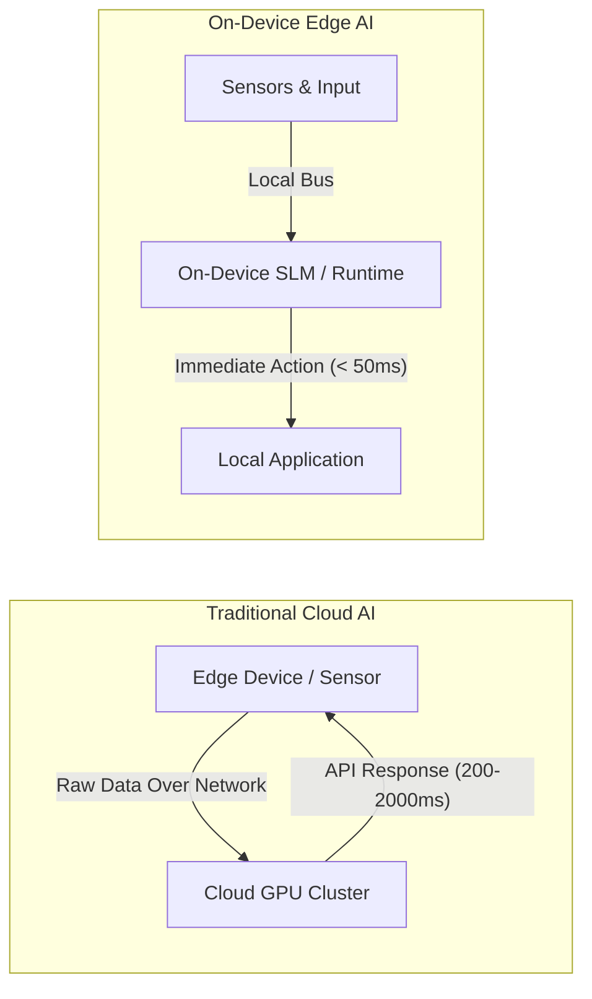

import QuizCard from '../../../components/islands/QuizCard';

You may know that building reliable AI agents in Course 07 gave us deterministic control over prompts, tools, and verification gates. Yet even the sharpest agent harness hits a physical wall the moment every inference call must travel over the internet to a distant GPU cluster. When a factory camera needs to spot a defect in 15 milliseconds, or a medical monitor must summarize patient vitals offline, waiting on a cloud round-trip simply breaks the system.

**Edge AI** moves model execution directly onto the hardware where data is generated: smartphones, laptops, industrial controllers, vehicles, and embedded boards. Instead of streaming raw sensor feeds to remote servers, **Small Language Models (SLMs)** run locally with low latency, predictable costs, and strict data sovereignty.

---

## Cloud AI vs. Edge AI: The Architectural Shift

Traditional cloud AI centralizes compute on massive data center GPUs. Your device captures an input, serializes it over HTTPS, waits in a multi-tenant inference queue, and streams tokens back. Edge AI collapses that entire network hop into a local hardware call.



Three converging shifts make on-device intelligence practical today:

1. **Dedicated AI Silicon**: Modern consumer and embedded chips (Apple Silicon Neural Engine, Qualcomm Hexagon NPU, NVIDIA Jetson Tensor Cores) pack tens of trillions of operations per second (TOPS) into a few watts.
2. **Compact Small Language Models**: Models between 1B and 14B parameters (such as Phi-4, Gemma 3, Qwen3, and Mistral-7B) retain roughly 80 to 90 percent of much larger cloud model capability at 10 to 20 percent of the memory footprint.
3. **Industrial Privacy & Reliability Demands**: Healthcare (HIPAA), finance, defense, and remote industrial sites require offline resilience and zero third-party data exposure.

---

## Core Pillars & Industry Impact

Every production Edge AI system is designed around five engineering pillars: **Proximity Processing**, **Decentralized Intelligence**, **Data Sovereignty**, **Autonomous Operation**, and **Embedded AI**.

| Capability | Cloud Large Language Models | On-Device Small Language Models |
| :--- | :--- | :--- |
| **Parameter Scale** | 70B to 405B+ parameters | 330M to 14B parameters |
| **Memory Footprint** | 40 GB to 200+ GB VRAM | 0.4 GB to 16 GB RAM/VRAM |
| **End-to-End Latency** | 500ms to 10s (network + queue) | 50ms to 500ms (local) |
| **Offline Resilience** | Fails without connectivity | Operates 100% air-gapped |
| **Operating Cost** | Ongoing per-token API spend | One-time hardware + local power |
| **Data Privacy** | Prompts leave device boundary | Data stays strictly on-device |

Across real-world industries, this trade-off unlocks measurable gains:

- **Manufacturing & Industry 4.0**: Siemens runs on-device predictive maintenance and defect detection at the factory line, cutting unplanned downtime by 30 to 50 percent and maintenance costs by 25 percent.
- **Healthcare & Medical Imaging**: Philips deploys local diagnostic imaging models at the point of care, helping radiologists complete assessments 40 percent faster at 99 percent diagnostic accuracy without uploading patient scans.
- **Autonomous Transportation**: Tesla's on-board inference stack evaluates local camera and sensor feeds at 40+ decisions per second without relying on cellular towers.
- **Smart Cities & Consumer Devices**: Singapore coordinates 100,000+ distributed traffic sensors to cut commute times by 25 percent, while Apple's Neural Engine runs 15.8 trillion operations per second locally for real-time translation and computational photography.

---

## Quantifying Latency and Bandwidth Savings

We can model the total response latency $L_{\text{total}}$ of an inference request as the sum of network round-trip time, server queuing, prompt prefill, and autoregressive token decoding:

$$
L_{\text{total}} = L_{\text{rtt}} + L_{\text{queue}} + L_{\text{prefill}} + N_{\text{tok}} \cdot L_{\text{decode}}
$$

Think of this like ordering coffee: $L_{\text{rtt}}$ is the drive to the café and back, $L_{\text{queue}}$ is waiting in line, $L_{\text{prefill}}$ is the barista reading your order, and $N_{\text{tok}} \cdot L_{\text{decode}}$ is pouring each cup (each output token). Running on-device sets the drive ($L_{\text{rtt}}$) and line ($L_{\text{queue}}$) to zero.

Furthermore, when an edge node filters raw telemetry locally and only escalates anomalies occurring at rate $\rho_{\text{anomaly}} \in [0, 1]$, the upstream bandwidth saved per device is:

$$
B_{\text{saved}} = R_{\text{sensor}} \cdot (1 - \rho_{\text{anomaly}})
$$

Here $R_{\text{sensor}}$ is the raw sensor data rate, and $(1 - \rho_{\text{anomaly}})$ is the fraction of normal, routine readings that never need to leave the device.

By the way, even when a local model decodes slightly slower per token than a data center H100, eliminating a 350ms network round-trip and cold queue often makes the user-perceived response feel instantaneous.

---

## Try It Yourself: Cloud vs. Edge Latency & Bandwidth Simulator

Run this Python simulation to compare total response time and monthly bandwidth usage across three workloads: an autonomous vehicle perception loop, a hospital point-of-care assistant, and an industrial sensor gateway.

**Cloud vs. Edge Latency & Bandwidth Simulator**

```python
from dataclasses import dataclass

@dataclass
class Workload:
    name: str
    cloud_rtt_ms: float
    cloud_queue_ms: float
    cloud_compute_ms: float
    edge_compute_ms: float
    anomaly_escalation_rate: float

workloads = [
    Workload("Autonomous Perception", 180.0, 250.0, 35.0, 22.0, 0.01),
    Workload("Clinical Point-of-Care", 220.0, 400.0, 120.0, 180.0, 0.00),
    Workload("Factory Anomaly Gateway", 150.0, 300.0, 60.0, 45.0, 0.05),
]

for w in workloads:
    cloud_total = w.cloud_rtt_ms + w.cloud_queue_ms + w.cloud_compute_ms
    edge_total = w.edge_compute_ms
    speedup = cloud_total / edge_total
    bw_saved = (1.0 - w.anomaly_escalation_rate) * 100.0
    print(
        f"Workload: {w.name} | Cloud={cloud_total:.1f}ms | "
        f"Edge={edge_total:.1f}ms | Speedup={speedup:.2f}x | "
        f"Bandwidth Saved={bw_saved:.1f}%"
    )
```

**Expected Output:**

```text
Workload: Autonomous Perception | Cloud=465.0ms | Edge=22.0ms | Speedup=21.14x | Bandwidth Saved=99.0%
Workload: Clinical Point-of-Care | Cloud=740.0ms | Edge=180.0ms | Speedup=4.11x | Bandwidth Saved=100.0%
Workload: Factory Anomaly Gateway | Cloud=510.0ms | Edge=45.0ms | Speedup=11.33x | Bandwidth Saved=95.0%
```

---

## Check Your Understanding

<QuizCard
  client:visible
  question="A factory quality-control camera must classify defects within 50ms even when plant Wi-Fi drops, and proprietary board designs cannot leave the premises. Which architectural choice best satisfies these constraints?"
  options={[
    "Stream uncompressed 1080p video to a 405B cloud LLM API over HTTPS.",
    "Deploy a quantized Small Language / Vision Model directly on an on-premise edge accelerator so inference runs locally with zero network round-trips.",
    "Increase the cloud API timeout to 5 seconds and add exponential backoff retries.",
    "Store video locally and batch-upload it to the cloud once per week."
  ]}
  correctAnswer={1}
  explanation="On-device edge inference eliminates network round-trips (meeting the 50ms latency budget), operates offline during Wi-Fi outages, and keeps proprietary manufacturing data strictly on-premises."
/>
