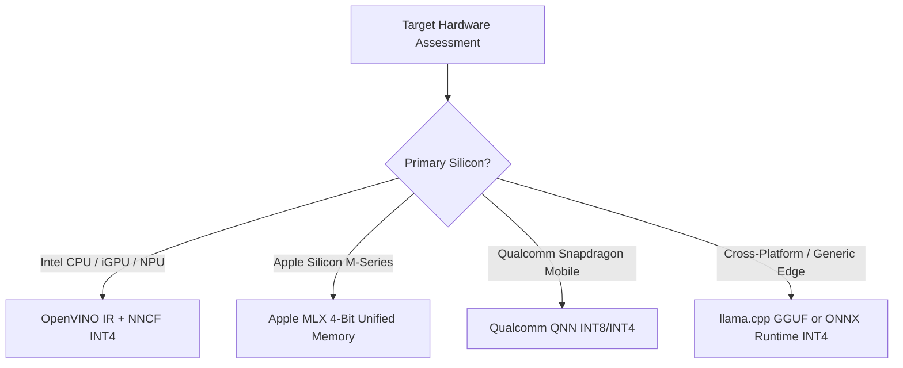

import QuizCard from '../../../components/islands/QuizCard';
import ColabButton from '../../../components/static/ColabButton.astro';

You may know that quantizing weights is only half the optimization story. Even a 4-bit model wastes huge amounts of energy if every LayerNorm, GeLU, and Matrix Multiply writes intermediate activations back out to DRAM. **Hardware-aware optimization** combines **operator fusion**, **calibrated compression**, and **silicon-specific execution providers** to match the model graph to the chip underneath.

Here is an overview of the four major optimization toolkits and a unified decision matrix for choosing the right pipeline.

---

## Cross-Platform Optimization Toolkits

Each hardware vendor provides a specialized toolkit to squeeze maximum speed out of its silicon:
- **ONNX Runtime + Olive**: The universal Swiss-army knife—exports models into a standard graph and fuses operations across CPUs, GPUs, and NPUs.
- **Intel OpenVINO + NNCF**: Compiles graphs into Intel's Intermediate Representation (`.xml`/`.bin`) tuned for Intel laptops, Core Ultra NPUs, and edge kiosks.
- **Apple MLX (`mlx-lm`)**: Built specifically for Apple Silicon's unified memory, letting the CPU and GPU share the same RAM without copying tensors back and forth.
- **Qualcomm QNN**: Splits model layers across Snapdragon's Hexagon NPU, Adreno GPU, and Kryo CPU for mobile efficiency.

| Framework | Primary Silicon Target | Compression & Fusion Techniques | Typical Gains |
| :--- | :--- | :--- | :--- |
| **ONNX Runtime + Olive** | Cross-platform CPU, GPU, NPU | Graph operator fusion, dynamic/static INT4 & INT8 | 60–75% size cut, 2–6x speedup |
| **Intel OpenVINO + NNCF** | Intel Core, Iris Xe, Movidius VPU | OpenVINO IR (`.xml`/`.bin`), NNCF INT4/INT8 weight compression | 50–75% size cut, 2–5x speedup |
| **Apple MLX (`mlx-lm`)** | Apple Silicon (M1–M4 Unified Memory) | Zero-copy unified RAM arrays, Metal shaders, 4-bit quantization | ~4 GB 7B footprint, 2–4x speedup |
| **Qualcomm QNN** | Snapdragon Hexagon NPU, Adreno GPU, Kryo CPU | Heterogeneous layer partitioning, INT8/INT16 mixed precision | 50–80% size cut, 5–15x mobile speedup |

### Why Operator Fusion Matters

Think of **operator fusion** like cooking a stir-fry in one pan instead of plating the food, putting it in the fridge, and pulling it back out after every single ingredient. When $K$ sequential operators (for example, `MatMul` + `Add` + `RMSNorm`) execute unfused, each intermediate activation tensor $A_k$ is written to slow main DRAM and read right back. Fusing those operators inside fast on-chip SRAM eliminates DRAM round-trips equal to:

$$
\Delta B_{\text{DRAM}} = \sum_{k=1}^{K-1} 2 \cdot |A_k| \cdot \text{sizeof}(\text{dtype})
$$

Here $|A_k|$ is the number of elements in intermediate tensor $k$, $\text{sizeof}(\text{dtype})$ is the bytes per element (e.g., 2 bytes for FP16), and the factor of `2` counts both the write out to DRAM and the read back in.

To rank candidate optimized builds objectively, we use a **Production Readiness Score** balancing latency, memory footprint, and perplexity drift $\Delta\text{PPL}$:

$$
S_{\text{hw}} = w_1 \frac{T_{\text{target}}}{T_{\text{meas}}} + w_2 \frac{M_{\text{budget}}}{M_{\text{meas}}} - w_3 \, \Delta\text{PPL}
$$

Higher $S_{\text{hw}}$ is better: beating your latency target ($T_{\text{target}} / T_{\text{meas}} > 1$) and staying under your memory budget ($M_{\text{budget}} / M_{\text{meas}} > 1$) push the score up, while accuracy degradation ($\Delta\text{PPL}$) subtracts a penalty.



---

## Open the Companion Colab Notebook

Launch the companion notebook to export a PyTorch network to ONNX, apply dynamic INT8 quantization, and run compiled Intel OpenVINO inference on Colab CPU.

<ColabButton
  course="edge-ai-for-beginners"
  notebook="12-hardware-aware-optimization-onnx-openvino-mlx-and-qnn.ipynb"
  runtime="Colab Free CPU"
/>

---

## Try It Yourself: Hardware-Aware Framework Selector & Readiness Gate

Run this Python workflow synthesizer to select the optimal optimization framework for three edge targets and evaluate whether each candidate passes the latency, memory, and perplexity-drift production gate.

**Edge Optimization Workflow Synthesizer**

```python
def select_framework(silicon):
    mapping = {
        "intel": "OpenVINO + NNCF INT4",
        "apple": "Apple MLX 4-bit",
        "qualcomm": "Qualcomm QNN INT8/4",
    }
    return mapping.get(silicon, "llama.cpp GGUF Q4_K_M")

targets = [
    ("Intel Edge Kiosk", "intel", 40.0, 50.0, 4.0, 2.5, 0.15),
    ("Apple M3 Laptop",  "apple", 28.0, 50.0, 8.0, 4.2, 0.12),
    ("Snapdragon Phone", "qualcomm", 22.0, 40.0, 3.0, 1.8, 0.20),
]

for name, silicon, t_meas, t_tgt, m_bud, m_meas, dppl in targets:
    fw = select_framework(silicon)
    score = 0.5 * (t_tgt / t_meas) + 0.5 * (m_bud / m_meas) - 0.1 * dppl
    gate = "PASS" if (t_meas <= t_tgt and m_meas <= m_bud and dppl <= 0.5) else "FAIL"
    print(f"Target: {name:18s} -> Framework={fw:20s} | Gate={gate} (score={score:.2f})")
```

**Expected Output:**

```text
Target: Intel Edge Kiosk   -> Framework=OpenVINO + NNCF INT4 | Gate=PASS (score=1.41)
Target: Apple M3 Laptop    -> Framework=Apple MLX 4-bit      | Gate=PASS (score=1.83)
Target: Snapdragon Phone   -> Framework=Qualcomm QNN INT8/4  | Gate=PASS (score=1.72)
```

---

## Check Your Understanding

<QuizCard
  client:visible
  question="Which optimization framework is specifically designed to exploit Apple Silicon's unified memory architecture without CPU-to-GPU memory copies?"
  options={[
    "Qualcomm QNN",
    "Apple MLX (mlx-lm)",
    "Intel Movidius VPU SDK",
    "Windows DirectML"
  ]}
  correctAnswer={1}
  explanation="Apple MLX is built natively for Apple Silicon's unified memory architecture, allowing CPU and Metal GPU kernels to share arrays with zero memory-copy overhead."
/>
