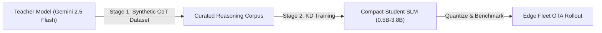

import QuizCard from '../../../components/islands/QuizCard';
import ColabButton from '../../../components/static/ColabButton.astro';

You may know that traditional MLOps assumes your model lives in a centralized cloud cluster with elastic GPUs and instant rollbacks. **SLMOps (Small Language Model Operations)** flips that assumption: models are shipped to thousands of heterogeneous edge devices with intermittent connectivity, strict privacy boundaries, and tight memory ceilings.

Here is an overview of the SLMOps lifecycle and how **two-stage Knowledge Distillation** transfers frontier reasoning from a cloud teacher (`gemini-2.5-flash` on Google AI Studio Free Tier) into a compact edge student SLM.

---

## SLMOps vs. Traditional MLOps

| Operational Dimension | Traditional Cloud MLOps | Edge SLMOps |
| :--- | :--- | :--- |
| **Deployment Target** | Homogeneous data center GPU clusters | Heterogeneous CPUs, NPUs, phones, and IoT gateways |
| **Cost Structure** | Variable per-token / GPU-hour OpEx | Predictable CapEx + minimal OTA bandwidth |
| **Rollout Strategy** | Blue-green API traffic shifting | Staged canary OTA updates with hardware validation gates |
| **Privacy Boundary** | Telemetry & prompts sent to cloud | Local inference; only anonymized drift metrics leave |
| **Optimization Loop** | Scale up replicas on load spikes | Distill, quantize, prune, and re-benchmark |

---

## Two-Stage Knowledge Distillation with Gemini

Knowledge distillation trains a compact **student model** (such as `Qwen2.5-0.5B` or `Phi-4-mini`) to mimic a much larger **teacher model** (`gemini-2.5-flash`), achieving up to an **85 percent latency reduction** and **95 percent memory reduction** while retaining **~92 percent** of teacher task accuracy:



Mathematically, **soft-target distillation** uses a temperature $T > 1$ to soften logits $z_T$ and $z_S$ so the student learns the teacher's "dark knowledge" (relative probabilities across runner-up classes):

$$
\mathcal{L}_{\text{KD}} = (1 - \alpha)\,\mathcal{L}_{\text{CE}}\big(y, \sigma(z_S)\big) + \alpha \, T^2 \, D_{\text{KL}}\!\left(\sigma\!\left(\frac{z_T}{T}\right) \;\middle\|\; \sigma\!\left(\frac{z_S}{T}\right)\right)
$$

In plain English, this loss blends two teachers into one scorecard:
- **Hard-Label Term $(1-\alpha)\,\mathcal{L}_{\text{CE}}$**: Checks whether the student's predictions $\sigma(z_S)$ match the true ground-truth answer $y$.
- **Soft-Teacher Term $\alpha\,T^2\,D_{\text{KL}}$**: Measures how closely the student's softened probability curve matches the teacher's softened curve $\sigma(z_T/T)$, where $\alpha \in [0, 1]$ balances how much weight to give the teacher vs. the ground truth. Multiplying the KL term by $T^2$ keeps gradient magnitudes invariant as temperature $T$ changes.

---

## Open the Companion Colab Notebook

Launch the companion notebook to generate synthetic reasoning traces using **Google AI Studio Free Tier** (`gemini-2.5-flash`, with offline fallback) and compute the PyTorch KL-divergence distillation loss.

<ColabButton
  course="edge-ai-for-beginners"
  notebook="13-slmops-lifecycle-and-knowledge-distillation-with-gemini.ipynb"
  runtime="Colab Free T4 GPU"
/>

---

## Try It Yourself: Temperature-Scaled KL Distillation Loss Calculator

Run this pure-Python implementation of temperature-scaled softmax, cross-entropy, and Kullback-Leibler divergence to observe how temperature $T = 2.0$ reveals relative class probabilities from teacher logits.

**Knowledge Distillation Soft-Target KL Loss**

```python
import math

def softmax(logits, temp=1.0):
    scaled = [z / temp for z in logits]
    m = max(scaled)
    exps = [math.exp(z - m) for z in scaled]
    s = sum(exps)
    return [e / s for e in exps]

teacher_logits = [4.0, 0.9, -1.3]
student_logits = [2.1, 1.4, -0.1]
true_idx = 0
T = 2.0
alpha = 0.7

p_s_hard = softmax(student_logits, 1.0)
ce_loss = -math.log(p_s_hard[true_idx])

p_t_soft = softmax(teacher_logits, T)
p_s_soft = softmax(student_logits, T)
kl_div = sum(pt * math.log(pt / ps) for pt, ps in zip(p_t_soft, p_s_soft))
scaled_kl = (T ** 2) * kl_div
total_kd = (1.0 - alpha) * ce_loss + alpha * scaled_kl

print("Teacher Soft Probs (T=2.0):", [round(x, 4) for x in p_t_soft])
print("Student Soft Probs (T=2.0):", [round(x, 4) for x in p_s_soft])
print(f"Hard CE Loss: {ce_loss:.4f} | Scaled KL Loss: {scaled_kl:.4f} | Combined KD Loss (alpha={alpha}): {total_kd:.4f}")
```

**Expected Output:**

```text
Teacher Soft Probs (T=2.0): [0.7795, 0.1654, 0.0551]
Student Soft Probs (T=2.0): [0.4908, 0.3458, 0.1634]
Hard CE Loss: 0.4746 | Scaled KL Loss: 0.7149 | Combined KD Loss (alpha=0.7): 0.6428
```

---

## Check Your Understanding

<QuizCard
  client:visible
  question="Why does knowledge distillation apply a temperature T > 1 to teacher and student logits inside the KL-divergence term?"
  options={[
    "To make the teacher output completely random tokens.",
    "To soften the probability distribution so the student learns relative similarities across non-target classes ('dark knowledge'), not just the single argmax label.",
    "To double the number of layers in the student model.",
    "To convert floating-point logits into ASCII strings."
  ]}
  correctAnswer={1}
  explanation="At T = 1, a confident teacher puts ~99% probability on the top class and near-zero on others. Raising T > 1 exposes the relative ranking of runner-up classes, giving the student richer gradient signal."
/>
