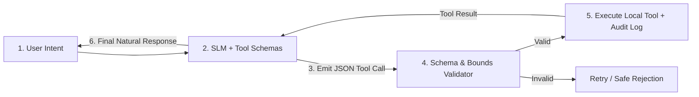

import PythonRunner from '../../../components/islands/PythonRunner';
import QuizCard from '../../../components/islands/QuizCard';
import ColabButton from '../../../components/static/ColabButton.astro';

You may know that a Small Language Model on its own is just a frozen text predictor: it cannot read a live temperature sensor, query a local SQLite log, or toggle a relay. **Function calling** bridges that gap by turning natural language intent into structured JSON tool invocations, letting sub-10B SLMs act as **autonomous edge agents** at 10 to 30x lower cost than cloud LLMs.

Here is an overview of the agent taxonomy, the 6-step SLM function calling loop, and the guardrails that keep edge agents safe.

---

## Edge Agent Taxonomy & The 6-Step Function Calling Loop

Edge agents span four operational tiers:
- **Simple Reflex Agents**: Stateless rule/intent triggers (thermostats, voice commands).
- **Model-Based Agents**: Track local state across turns (autonomous vacuums, local robotics).
- **Goal-Based Agents**: Plan multi-step tool sequences to reach an objective.
- **Learning Agents**: Adapt routing or tool selection from local feedback.

Every function-calling SLM executes a deterministic 6-step cycle:

For a $K$-step agent workflow, end-to-end reliability compounds exponentially with per-step schema accuracy $p_{\text{schema}}$ and argument accuracy $p_{\text{args}}$:

$$
R_{\text{chain}} = \big(p_{\text{schema}} \cdot p_{\text{args}}\big)^K
$$

That is why **grammar-constrained decoding** (forcing the sampler to emit valid JSON matching your schema so $p_{\text{schema}} \to 1.0$) combined with strict server-side bounds checking and rate limiting is essential on edge SLMs.

## Production Guardrails for Local Tool Loops

Running function-calling SLMs close to physical hardware or local databases requires defensive engineering beyond schema syntax:

| Guardrail Layer | Failure Mode Prevented | Edge Implementation |
| :--- | :--- | :--- |
| **Schema & Bounds Validation** | Hallucinated types or extreme numeric values | Pydantic `Field(ge=..., le=...)` before execution |
| **Rate Limiting & Circuit Breakers** | Infinite retry loops draining battery | Per-minute tool call quota + max step cap |
| **Immutable Audit Logging** | Silent state corruption on edge devices | Append-only JSONL trace with timestamps and arguments |
| **Platform Tool Formats** | Prompt template mismatch across SLMs | OpenAI `tools` JSON (`Phi-4-mini`, `Ollama`) or `<tool_call>` tags (`Qwen3`) |

---

## Open the Companion Colab Notebook

Launch the companion notebook to implement typed Pydantic tool guardrails and run local SLM tool dispatch on Google Colab.

<ColabButton
  course="edge-ai-for-beginners"
  notebook="15-edge-ai-agents-and-slm-function-calling.ipynb"
  runtime="Colab Free CPU"
/>

---

## Try It Yourself: 6-Stage SLM Function Calling Dispatcher & Guardrail

Run this pure-Python edge agent dispatcher to validate SLM JSON tool calls, block out-of-range hardware commands, and emit an immutable audit log.

<PythonRunner
  client:visible
  title="Try it Yourself: Edge SLM Function Calling Dispatcher"
  expectedOutput="Dispatch 1: {'status': 'ok', 'sensor': 'turbine_01', 'temp_c': 68.4}
Dispatch 2: {'status': 'blocked', 'reason': 'rpm 9500 exceeds safe limit [500, 4500]'}
Audit Log Entries: 2"
  initialCode={`import json

audit_log = []

def read_sensor(sensor_id):
    readings = {"turbine_01": 68.4, "compressor_02": 54.1}
    if sensor_id not in readings:
        return {"status": "error", "reason": "unknown sensor"}
    return {"status": "ok", "sensor": sensor_id, "temp_c": readings[sensor_id]}

def set_fan_rpm(rpm):
    if not isinstance(rpm, int) or not (500 <= rpm <= 4500):
        return {"status": "blocked", "reason": f"rpm {rpm} exceeds safe limit [500, 4500]"}
    return {"status": "ok", "rpm": rpm}

TOOLS = {"read_sensor": read_sensor, "set_fan_rpm": set_fan_rpm}

def execute_slm_tool_call(raw_json):
    call = json.loads(raw_json)
    fn_name = call["name"]
    args = call["arguments"]
    result = TOOLS[fn_name](**args)
    audit_log.append({"tool": fn_name, "args": args, "status": result["status"]})
    return result

r1 = execute_slm_tool_call('{"name": "read_sensor", "arguments": {"sensor_id": "turbine_01"}}')
r2 = execute_slm_tool_call('{"name": "set_fan_rpm", "arguments": {"rpm": 9500}}')

print("Dispatch 1:", r1)
print("Dispatch 2:", r2)
print("Audit Log Entries:", len(audit_log))`}
/>

---

## Check Your Understanding

<QuizCard
  client:visible
  question="In a 5-step edge agent workflow, why should developers enforce both grammar-constrained JSON output and server-side bounds validation?"
  options={[
    "Because multi-step reliability compounds as (p_schema * p_args)^K, so malformed JSON or unsafe out-of-range arguments can derail the workflow or damage edge hardware.",
    "Because JSON schemas automatically compress model weights to 4 bits.",
    "Because SLMs cannot output numbers without a cloud connection.",
    "Because bounds validation replaces the need for unit tests."
  ]}
  correctAnswer={0}
  explanation="Even a small per-step schema or parameter error compounds across K steps, and deterministic bounds validation guarantees that hallucinated arguments cannot trigger unsafe local hardware actions."
/>
