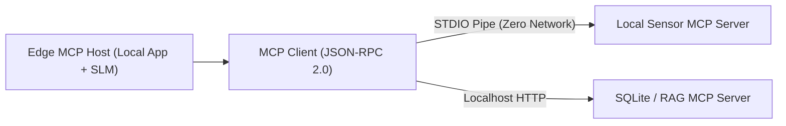

import QuizCard from '../../../components/islands/QuizCard';
import ColabButton from '../../../components/static/ColabButton.astro';

You may know from Course 05 that the **Model Context Protocol (MCP)** acts as a universal USB-C port for AI applications. Pairing MCP with **on-device Small Language Models** creates an ideal synergy: external MCP servers compensate for an SLM's compact parameter count by supplying live local databases, sensor telemetry, and filesystem tools without ever sending data off the device.

Here is an overview of how MCP's two-layer architecture works on edge hardware using `stdio` and Streamable HTTP transports.

---

## Two-Layer On-Device MCP Architecture

MCP cleanly separates message semantics from transport plumbing:

1. **Data Layer (JSON-RPC 2.0)**: Handles lifecycle initialization (`initialize`), capability negotiation, core primitives (`tools`, `resources`, `prompts`), and structured error reporting.
2. **Transport Layer**:
   - **`stdio` Transport**: Spawns the MCP tool server as an isolated local subprocess communicating over standard input/output streams. Zero network stack, zero open TCP ports, sub-millisecond IPC latency.
   - **Streamable HTTP / SSE Transport**: Connects an edge host to a containerized local service (for example, an on-premise Ollama or vLLM + tool gateway) over `http://127.0.0.1`.



Total local tool-augmented turn latency decomposes cleanly into:

$$
L_{\text{MCP}} = L_{\text{SLM\_intent}} + L_{\text{IPC\_stdio}} + L_{\text{tool\_exec}} + L_{\text{SLM\_synth}}
$$

Because `stdio` IPC overhead ($L_{\text{IPC\_stdio}}$) is typically $< 1\text{ ms}$, almost the entire latency budget belongs to the quantized SLM itself.

## Multi-Backend Support & Developer Tooling

A clean MCP host decouples tool discovery from the underlying inference engine. During local prototyping on a laptop, you can back the host with **Ollama** (`http://localhost:11434/v1`) or **AI Toolkit for VS Code**'s Agent Builder; when promoting to an on-premise edge server, swap the exact same MCP client to **vLLM** or **ONNX Runtime** without touching a single line of server code.

| Transport Mode | Channel Mechanism | Typical Edge Use Case | Security Posture |
| :--- | :--- | :--- | :--- |
| **`stdio`** | Parent-child OS stdin/stdout pipes | Local filesystem, SQLite, hardware sensors | Process-isolated, zero network ports |
| **Streamable HTTP / SSE** | Localhost HTTP POST + event stream | Shared containerized RAG or multi-agent gateway | Bind to `127.0.0.1` + bearer token |

---

## Open the Companion Colab Notebook

Launch the companion notebook to install the open-source Python `mcp` SDK (`FastMCP`), spin up a `stdio` edge diagnostics server, and execute `tools/list` and `tools/call` end-to-end.

<ColabButton
  course="edge-ai-for-beginners"
  notebook="16-on-device-mcp-integration-for-edge-slms.ipynb"
  runtime="Colab Free CPU"
/>

---

## Try It Yourself: In-Memory JSON-RPC 2.0 MCP Host-Server Loop

Run this pure-Python JSON-RPC 2.0 MCP simulator to trace `initialize`, `tools/list`, and `tools/call` frames between a local SLM host and an on-device sensor MCP server.

**On-Device MCP JSON-RPC 2.0 Simulator**

```python
def mcp_server_handle(req):
    method = req["method"]
    req_id = req["id"]
    if method == "initialize":
        return {"jsonrpc": "2.0", "id": req_id, "result": {"protocolVersion": "2026-07-28", "serverInfo": {"name": "EdgeSensorMCP"}}}
    if method == "tools/list":
        return {"jsonrpc": "2.0", "id": req_id, "result": {"tools": [{"name": "read_npu_stats", "description": "Read NPU utilization and power"}]}}
    if method == "tools/call":
        name = req["params"]["name"]
        if name == "read_npu_stats":
            return {"jsonrpc": "2.0", "id": req_id, "result": {"npu_util_pct": 42, "power_w": 1.5}}
    return {"jsonrpc": "2.0", "id": req_id, "error": {"code": -32601, "message": "Method not found"}}

init_resp = mcp_server_handle({"jsonrpc": "2.0", "id": 1, "method": "initialize"})
list_resp = mcp_server_handle({"jsonrpc": "2.0", "id": 2, "method": "tools/list"})
call_resp = mcp_server_handle({"jsonrpc": "2.0", "id": 3, "method": "tools/call", "params": {"name": "read_npu_stats", "arguments": {}}})

print("Initialize:", init_resp)
print("Tools List:", [t["name"] for t in list_resp["result"]["tools"]])
print("Tool Call: ", call_resp)
```

**Expected Output:**

```text
Initialize: {'jsonrpc': '2.0', 'id': 1, 'result': {'protocolVersion': '2026-07-28', 'serverInfo': {'name': 'EdgeSensorMCP'}}}
Tools List: ['read_npu_stats']
Tool Call:  {'jsonrpc': '2.0', 'id': 3, 'result': {'npu_util_pct': 42, 'power_w': 1.5}}
```

---

## Check Your Understanding

<QuizCard
  client:visible
  question="Why is STDIO transport preferred for local on-device MCP tool servers on edge hardware?"
  options={[
    "It communicates over direct standard input/output pipes with sub-millisecond IPC overhead and exposes zero open TCP ports on the network.",
    "It requires an active internet connection and OAuth 2.1 cloud redirect.",
    "It automatically converts JSON-RPC into XML.",
    "It bypasses all tool argument validation."
  ]}
  correctAnswer={0}
  explanation="STDIO transport runs the MCP server as a local subprocess communicating over OS pipes, eliminating network latency and attack surface on edge devices."
/>
