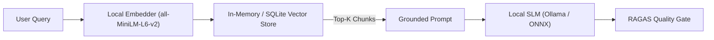

import QuizCard from '../../../components/islands/QuizCard';
import ColabButton from '../../../components/static/ColabButton.astro';

You may know that Small Language Models cannot memorize every internal company SOP or maintenance manual inside 3.8B weights. **Local Retrieval-Augmented Generation (RAG)** solves that cleanly: it embeds private documents on-device using compact encoders like `all-MiniLM-L6-v2` (22M parameters), retrieves only the top-K relevant snippets, and grounds the local SLM prompt without ever sending proprietary files to the cloud.

Here is an overview of the local RAG pipeline architecture, import-safe client factory patterns, and how **RAGAS** metrics quantify whether your edge model is hallucinating.

---

## Local Edge RAG Architecture & Client Factory

A resilient edge RAG service wraps optional dependencies cleanly (guarding `sentence_transformers` imports) and uses a **Client Factory** so the same pipeline runs against a local `Ollama` / `llama.cpp` server offline or escalates to `gemini-2.5-flash` when authorized.

Because edge SLMs typically operate with tighter context windows (2K to 8K tokens) than cloud models, chunking discipline matters: keep document chunks between 200 and 400 tokens with a 15 percent overlap, and instruct the system prompt to cite only retrieved facts rather than guessing from parametric memory.



---

## Evaluating Quality with RAGAS Metrics

Measuring retrieval and generation separately prevents silent regressions when you quantize an SLM from FP16 to INT4:

1. **Cosine Similarity Retrieval**: Measures the angle between query vector $q$ and document vector $d$ (ignoring document length)—`1.0` means identical topic direction, `0.0` means unrelated:
   $$
   \text{sim}(q, d) = \frac{q \cdot d}{\|q\|_2 \, \|d\|_2}
   $$
2. **RAGAS Faithfulness ($F$)**: Breaks the answer into individual factual claims ($|V_{\text{claims}}|$) and counts how many are actually backed up by the retrieved text ($|V_{\text{supported}}|$)—catching hallucinations:
   $$
   F = \frac{|V_{\text{supported}}|}{|V_{\text{claims}}|}
   $$
3. **RAGAS Context Precision@K**: Checks whether the truly relevant chunks ($r_k = 1$) appear at the *top* of your top-$K$ search results rather than buried at the bottom:
   $$
   \text{CP@K} = \frac{\sum_{k=1}^{K} \text{Precision@}k \cdot r_k}{\text{Total Relevant in Top } K}
   $$

---

## Open the Companion Colab Notebook

Launch the companion notebook to run local vector retrieval with `sentence-transformers/all-MiniLM-L6-v2` and evaluate RAGAS Faithfulness on Google Colab.

<ColabButton
  course="edge-ai-for-beginners"
  notebook="17-local-rag-pipelines-and-ragas-quality-evaluation.ipynb"
  runtime="Colab Free CPU"
/>

---

## Try It Yourself: Local Vector RAG & RAGAS Evaluator

Run this pure-Python RAG engine to compute cosine similarity over normalized term-vectors, retrieve the top-2 passages, and score Faithfulness and Context Precision@2.

**Local Edge RAG & RAGAS Metrics Simulator**

```python
import math

docs = [
    ("doc_1", "INT4 quantization cuts SLM RAM by 75 percent for edge devices."),
    ("doc_2", "PagedAttention reduces KV cache fragmentation under 4 percent."),
    ("doc_3", "STDIO MCP servers isolate local tools without open TCP ports."),
]

def bow_cosine(a, b):
    wa = a.lower().replace(".", "").split()
    wb = b.lower().replace(".", "").split()
    vocab = set(wa) | set(wb)
    va = [wa.count(w) for w in vocab]
    vb = [wb.count(w) for w in vocab]
    dot = sum(x * y for x, y in zip(va, vb))
    na = math.sqrt(sum(x * x for x in va))
    nb = math.sqrt(sum(y * y for y in vb))
    return dot / (na * nb) if na and nb else 0.0

query = "INT4 quantization edge devices"
ranked = sorted(((bow_cosine(query, text), did, text) for did, text in docs), reverse=True)

print("Top-2 Retrieved Docs:")
for idx, (sim, did, text) in enumerate(ranked[:2], 1):
    print(f"  {idx}. [sim={sim:.4f}] {did}: {text}")

# RAGAS Faithfulness & Context Precision@2
claims_supported = [True, True, False]  # 2 grounded, 1 hallucinated extra
faithfulness = sum(claims_supported) / len(claims_supported)
relevant_flags = [1, 0]  # rank 1 relevant, rank 2 not relevant
prec_at_k = [sum(relevant_flags[:k]) / k for k in range(1, 3)]
cp_at_2 = sum(p * r for p, r in zip(prec_at_k, relevant_flags)) / sum(relevant_flags)

print(f"RAGAS Faithfulness: {faithfulness:.2f} ({sum(claims_supported)}/{len(claims_supported)} claims grounded)")
print(f"RAGAS Context Precision@2: {cp_at_2:.2f}")
```

**Expected Output:**

```text
Top-2 Retrieved Docs:
  1. [sim=0.6030] doc_1: INT4 quantization cuts SLM RAM by 75 percent for edge devices.
  2. [sim=0.0000] doc_3: STDIO MCP servers isolate local tools without open TCP ports.
RAGAS Faithfulness: 0.67 (2/3 claims grounded)
RAGAS Context Precision@2: 1.00
```

---

## Check Your Understanding

<QuizCard
  client:visible
  question="In RAGAS evaluation, what does a low Faithfulness score alongside a high Context Precision score indicate?"
  options={[
    "The retriever found the right documents, but the SLM hallucinated unsupported claims instead of sticking to the retrieved context.",
    "The vector database is empty.",
    "The user query was written in the wrong language.",
    "The embedding model has too many dimensions."
  ]}
  correctAnswer={0}
  explanation="High Context Precision means the retriever ranked relevant chunks at the top; low Faithfulness means the generator added claims not entailed by those retrieved chunks."
/>
