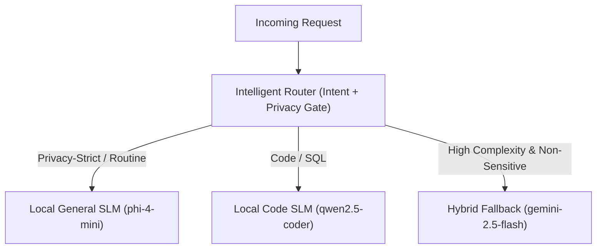

import PythonRunner from '../../../components/islands/PythonRunner';
import QuizCard from '../../../components/islands/QuizCard';
import ColabButton from '../../../components/static/ColabButton.astro';

You may know that forcing one general-purpose model to handle every query wastes memory when a tiny classifier would do, yet fails when a task requires deep multi-document synthesis. Treating **models as modular tools** behind an **Intelligent Model Router** solves both problems: routine, latency-sensitive, or privacy-strict queries stay on specialized local SLMs, while high-complexity queries escalate to **Google AI Studio (`gemini-2.5-flash`)**.

Here is an overview of the Models-as-Tools router pattern and how a **Coordinator Agent** orchestrates Retrieval, Reasoning, and Execution specialists on edge hardware.

---

## Intelligent Model Routing & Hybrid Cost Objective

A router maps incoming intent and privacy flags to a registry of specialized models (`general`, `code`, `reasoning`, `cloud_escalation`):

Expected hybrid cost per request scales with the local routing probability $P(\text{route} = \text{edge})$:

$$
C_{\text{hybrid}} = P(\text{route}=\text{edge})\cdot C_{\text{edge}} + P(\text{route}=\text{cloud})\cdot C_{\text{cloud}}
$$

subject to maintaining quality $Q_{\text{hybrid}} \ge Q_{\min}$. If 80 percent of queries resolve locally on-device ($C_{\text{edge}} \approx 0$), cloud API spend drops by 5x while preserving frontier capability for the hardest 20 percent.

---

## Coordinator-Specialist Multi-Agent Pattern

For multi-step edge workflows, a **Coordinator** delegates sub-tasks to three specialist agents with a refinement feedback loop:
1. **Retrieval Specialist**: Queries the local vector store or SQLite telemetry.
2. **Reasoning Specialist**: Synthesizes root causes and drafts an action plan.
3. **Execution Specialist**: Invokes validated MCP / function tools and returns verification status to the Coordinator.

By keeping each specialist's system prompt narrow and pairing it with the smallest SLM capable of that role (for example, `qwen2.5:0.5b` for intent routing, `qwen2.5-coder` for SQL/Python generation, and `phi-4-mini` for logical verification), multi-agent edge pipelines stay responsive even on consumer laptops and Jetson boards.

---

## Open the Companion Colab Notebook

Launch the companion notebook to run a Models-as-Tools task router with privacy-aware hybrid escalation on Google Colab.

<ColabButton
  course="edge-ai-for-beginners"
  notebook="19-models-as-tools-intelligent-routing-and-multi-agent-edge.ipynb"
  runtime="Colab Free CPU"
/>

---

## Try It Yourself: Models-as-Tools Router & Coordinator Pipeline

Run this Python orchestrator to route three queries across local specialist SLMs and hybrid Gemini fallback, then execute a 3-stage Coordinator-Specialist loop.

<PythonRunner
  client:visible
  title="Try it Yourself: Models-as-Tools Router & Multi-Agent Coordinator"
  expectedOutput="Route 1: 'Fix Python ONNX export' -> tool=code (qwen2.5-coder @ edge)
Route 2: 'Audit private HIPAA patient chart' -> tool=general (phi-4-mini @ edge)
Route 3: 'Synthesize 5-year market forecast' -> tool=cloud (gemini-2.5-flash @ cloud)
Coordinator Pipeline: [Retrieval: 2 chunks] -> [Reasoning: plan_ok] -> [Execution: verified=True]"
  initialCode={`def route_request(prompt, privacy_strict=False):
    p = prompt.lower()
    if any(k in p for k in ("python", "sql", "onnx", "bug")):
        return "code", "qwen2.5-coder", "edge"
    if not privacy_strict and any(k in p for k in ("forecast", "synthesize", "global")):
        return "cloud", "gemini-2.5-flash", "cloud"
    return "general", "phi-4-mini", "edge"

queries = [
    ("Fix Python ONNX export", False),
    ("Audit private HIPAA patient chart", True),
    ("Synthesize 5-year market forecast", False),
]

for idx, (q, priv) in enumerate(queries, 1):
    tool, model, loc = route_request(q, priv)
    print(f"Route {idx}: '{q}' -> tool={tool} ({model} @ {loc})")

# 3-Specialist Coordinator Pipeline
retrieved = ["doc_a", "doc_b"]
plan_status = "plan_ok" if len(retrieved) >= 2 else "needs_more_context"
exec_verified = (plan_status == "plan_ok")
print(f"Coordinator Pipeline: [Retrieval: {len(retrieved)} chunks] -> [Reasoning: {plan_status}] -> [Execution: verified={exec_verified}]")`}
/>

---

## Check Your Understanding

<QuizCard
  client:visible
  question="In a hybrid edge-cloud Models-as-Tools architecture, what rule must override complexity-based cloud escalation?"
  options={[
    "A strict privacy/data-sovereignty gate ensuring sensitive local data (such as HIPAA or proprietary records) never routes to external cloud APIs.",
    "Always sending every query to the cloud first to check spelling.",
    "Disabling all local code models during daytime hours.",
    "Removing the Coordinator agent from the pipeline."
  ]}
  correctAnswer={0}
  explanation="Data sovereignty and privacy policies must take precedence over complexity heuristics so confidential records remain strictly on-device."
/>
