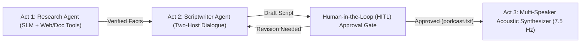

import PythonRunner from '../../../components/islands/PythonRunner';
import QuizCard from '../../../components/islands/QuizCard';
import ColabButton from '../../../components/static/ColabButton.astro';

You have made it to the final capstone of **Edge AI for Beginners** and the 9-course BuddhiAI Academy AI Engineering learning path. Across Courses 00 through 08, you progressed from Python fundamentals and neural networks from scratch to Transformers, MCP servers, autonomous agents, reliable harnesses, and quantized on-device SLMs.

Now we put every piece together in a 3-Act capstone project: **"Future Bytes"**, a 100 percent local multi-agent AI podcast studio that researches a tech topic, drafts a two-host script, enforces a human-in-the-loop (HITL) approval gate, and synthesizes multi-speaker podcast audio.

---

## Three-Act Multi-Agent Podcast Architecture

1. **Act 1 (Meet Your Research Assistant "Alex")**: A single local SLM (`Qwen3-8B` or `Qwen2.5` via Ollama/Colab) equipped with search tools and chain-of-thought reasoning gathers verified facts on the episode topic.
2. **Act 2 (Assemble Your Production Team)**: Contrast **Centralized** (one coordinator directs Research -> Scriptwriter -> HITL Editor) vs. **Decentralized** vs. **Hybrid** orchestration. Notice the critical distinction: an **Agent** improvises dynamically with tools (like a jazz musician), while a **Workflow** enforces deterministic stage ordering and human approval gates (like an orchestral score).
3. **Act 3 (Multi-Speaker Conversational Audio Synthesis)**: Modern conversational speech models (such as VibeVoice-7B or open-source multi-speaker TTS) pair an LLM with an acoustic diffusion head operating at an ultra-low **7.5 Hz** frame rate. For a 90-minute ($5,400\text{ s}$) podcast episode, frame count drops from $50\text{ Hz} \times 5400 = 270,000$ frames down to:

$$
N_{\text{frames}} = 7.5\text{ Hz} \times 5400\text{ s} = 40,500\text{ frames}
$$

a **$6.67\times$ sequence compression** that makes long-form multi-speaker audio generation practical on edge GPUs!

---

## Open the Companion Colab Notebook

Launch the capstone notebook to run the complete 3-Act "Future Bytes" pipeline and generate a playable podcast audio episode right inside Google Colab.

<ColabButton
  course="edge-ai-for-beginners"
  notebook="20-capstone-local-multi-agent-ai-podcast-studio.ipynb"
  runtime="Colab Free T4 GPU"
/>

---

## Try It Yourself: 3-Act "Future Bytes" Podcast Studio Simulator

Run this pure-Python orchestrator to execute Act 1 (Research Agent), Act 2 (Scriptwriter + HITL Approval Gate), and Act 3 (7.5 Hz Acoustic Frame Compression Calculator).

<PythonRunner
  client:visible
  title="Try it Yourself: 3-Act Future Bytes Podcast Studio Orchestrator"
  expectedOutput="Act 1 [Research Agent]: Collected 2 verified facts on Edge AI
Act 2 [Workflow + HITL Gate]: Approved 4-line script (Speakers: Speaker 1, Speaker 2)
Act 3 [Audio Synthesis @ 7.5 Hz]: 40,500 frames for 90 min (6.67x compression vs 50 Hz)"
  initialCode={`def act1_research_agent(topic):
    return [
        f"{topic} SLMs run locally at 50-500ms latency.",
        "Q4_K_M quantization cuts model memory by ~75%."
    ]

def act2_script_and_hitl(facts):
    script = [
        "Speaker 1: Welcome to Future Bytes! Today we cover Edge AI.",
        f"Speaker 2: {facts[0]}",
        f"Speaker 1: Plus, {facts[1]}",
        "Speaker 2: Local, fast, and private. See you next episode!"
    ]
    speakers = sorted({line.split(":", 1)[0] for line in script})
    approved = len(script) >= 4 and speakers == ["Speaker 1", "Speaker 2"]
    return approved, script, speakers

facts = act1_research_agent("Edge AI")
approved, script, speakers = act2_script_and_hitl(facts)

duration_sec = 90 * 60
frames_7_5hz = int(7.5 * duration_sec)
frames_50hz = int(50.0 * duration_sec)
compression = frames_50hz / frames_7_5hz

print(f"Act 1 [Research Agent]: Collected {len(facts)} verified facts on Edge AI")
print(f"Act 2 [Workflow + HITL Gate]: Approved {len(script)}-line script (Speakers: {', '.join(speakers)})")
print(f"Act 3 [Audio Synthesis @ 7.5 Hz]: {frames_7_5hz:,d} frames for 90 min ({compression:.2f}x compression vs 50 Hz)")`}
/>

---

## Check Your Understanding

<QuizCard
  client:visible
  question="In the 3-Act AI Podcast Studio architecture, why is a deterministic Workflow with a Human-in-the-Loop (HITL) gate paired with autonomous Agents?"
  options={[
    "Agents improvise research and drafting with tools, while the Workflow enforces predictable stage ordering and human quality approval before expensive audio synthesis runs.",
    "Because Workflows automatically delete all research facts.",
    "Because HITL gates convert 50 Hz audio to 7.5 Hz.",
    "Because Agents cannot run on local hardware without a Workflow."
  ]}
  correctAnswer={0}
  explanation="Pairing autonomous tool-using agents with a structured workflow and HITL approval gate gives you creative flexibility during research/drafting plus deterministic quality control before final audio rendering."
/>
