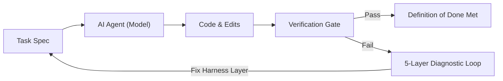

import PythonRunner from '../../../components/islands/PythonRunner';
import QuizCard from '../../../components/islands/QuizCard';
import ColabButton from '../../../components/static/ColabButton.astro';

You may know that frontier models routinely score above 75% on curated coding benchmarks like SWE-bench Verified. Yet the moment you hand an agent an everyday feature request—vague specs, zero existing tests, and implicit team conventions—it runs for twenty minutes, edits twelve files, and cheerfully declares "all done" while the test suite is broken.

When that happens, most developers reach for a more expensive model. Here is the reality: **when things fail, check the harness first, not the model weights.** Everything outside the model—instructions, tools, runtime environment, state files, and verification feedback—is the **harness**.

---

## Same Model, Completely Different Outcomes

Anthropic tested this directly by running the exact same prompt (*"build a 2D retro game editor"*) with the exact same model (Opus 4.5) under two different harnesses:

1. **Bare Run (Minimal Harness)**: Ran for 20 minutes at a cost of \$9. The application opened, but game entities did not respond to user input.
2. **Full Harness (Planner + Generator + Evaluator)**: Ran for 6 hours at a cost of \$200. Core gameplay worked because an independent evaluator clicked through the running app to catch broken interactions.

They did not swap the model. They changed the **tack** around the horse. OpenAI reported a similar breakthrough in their 5-month Codex experiment: starting from an empty repository, a small team of three engineers (later seven) merged roughly **1,500 PRs** (~1 million lines of agent-written code, averaging **3.5 PRs per engineer per day**) by systematically supplying whatever structural capability the agent was missing.

---

## The 5 Failure Modes & Diagnostic Layers

Rather than blaming the model, map every agent failure to one of five defense layers:

| Failure Mode | Harness Layer | Root Cause | Fix in Google Antigravity |
| :--- | :--- | :--- | :--- |
| **Vague Requirements** | Task Specification | Agent guesses pagination, auth, or edge cases | Write an explicit `Definition of Done` or run `/plan` |
| **Implicit Conventions** | Context Provision | Team rules live in Slack or senior heads, not the repo | Put conventions in `AGENTS.md` / `GEMINI.md` |
| **Broken Environment** | Execution Environment | Agent burns context debugging `pip` or Node versions | Provide `init.sh` + locked `pyproject.toml` |
| **No Verification (Context Anxiety)** | Verification Feedback | Agent senses low context and rushes a "looks fine" finish | Add runnable test/lint commands and `Stop` hooks |
| **Cross-Session State Loss** | State Management | Every new session re-discovers the repo from scratch | Persist `PROGRESS.md` and `feature_list.json` |

We can quantify the **Verification Gap** $G_{\text{verify}}$ across a batch of tasks as:

$$
G_{\text{verify}} = P(\text{agent claims done}) - P(\text{independent checks pass})
$$

If an agent claims completion on 90% of tasks while only 45% actually pass `pytest` and `mypy`, your harness has a $G_{\text{verify}} = 0.45$ reliability gap.

---

## Google AI Studio Free Tier & Antigravity First-Run Setup

Throughout this course, our Python labs run 100% free using **Google AI Studio Free Tier** (`gemini-2.5-flash` via the `google-genai` SDK) and **Google Colab Free Tier**—plus **Google Antigravity** (`AGENTS.md`, `GEMINI.md`, `/plan`, and `.agents/`).

1. **Get your free API key**: Visit [aistudio.google.com/apikey](https://aistudio.google.com/apikey) and click **Create API Key**.
2. **Store it safely in Colab**: Open the **Secrets (🔑)** sidebar in Google Colab, add `GEMINI_API_KEY`, and toggle notebook access on.
3. **Add a root `AGENTS.md` in Antigravity**: Even a 30-line `AGENTS.md` with your stack, architecture rules, and exact verification commands (`pytest tests/ -x && ruff check src/`) often outperforms upgrading to a larger model.

---

## Open the Companion Colab Notebook

Launch the companion notebook to run a live `google-genai` (`gemini-2.5-flash`) vs. deterministic offline **5-Layer Harness Diagnostic Loop** on underspecified vs. harness-backed tasks.

<ColabButton
  course="harness-engineering"
  notebook="01-why-capable-agents-still-fail.ipynb"
  runtime="Free Tier CPU"
/>

---

## Try It Yourself: Measure the Verification Gap & Attribute Failures

Run this pure-Python diagnostic simulator in your browser to compute $G_{\text{verify}}$ across 5 agent runs and attribute every failure to its exact harness layer.

<PythonRunner
  client:visible
  title="Try it Yourself: 5-Layer Harness Diagnostic Loop"
  expectedOutput="Baseline Verification Gap: 0.60 (claimed=0.80, verified=0.20)
Attributed Layers:
  - task-01: Task Specification (Vague search spec)
  - task-02: Verification Feedback (Skipped pytest + mypy)
  - task-03: Context Provision (Used SQLAlchemy 1.x instead of 2.0)
Harness-Backed Verification Gap: 0.00 (claimed=1.00, verified=1.00)"
  initialCode={`from dataclasses import dataclass

@dataclass
class AgentRun:
    task_id: str
    claimed_done: bool
    verified_pass: bool
    failure_layer: str
    reason: str

baseline_runs = [
    AgentRun("task-01", True, False, "Task Specification", "Vague search spec"),
    AgentRun("task-02", True, False, "Verification Feedback", "Skipped pytest + mypy"),
    AgentRun("task-03", True, False, "Context Provision", "Used SQLAlchemy 1.x instead of 2.0"),
    AgentRun("task-04", True, True, "None", "Passed"),
    AgentRun("task-05", False, False, "Execution Environment", "Missing dependency"),
]

def verification_gap(runs):
    claimed = sum(r.claimed_done for r in runs) / len(runs)
    verified = sum(r.verified_pass for r in runs) / len(runs)
    return claimed, verified, claimed - verified

c, v, g = verification_gap(baseline_runs)
print(f"Baseline Verification Gap: {g:.2f} (claimed={c:.2f}, verified={v:.2f})")
print("Attributed Layers:")
for r in baseline_runs:
    if r.claimed_done and not r.verified_pass:
        print(f"  - {r.task_id}: {r.failure_layer} ({r.reason})")

harness_runs = [
    AgentRun(f"task-0{i}", True, True, "None", "Passed AGENTS.md + Definition of Done")
    for i in range(1, 6)
]
hc, hv, hg = verification_gap(harness_runs)
print(f"Harness-Backed Verification Gap: {hg:.2f} (claimed={hc:.2f}, verified={hv:.2f})")`}
/>

---

## Check Your Understanding

<QuizCard
  client:visible
  question="An agent runs for 20 minutes, declares a task complete, and you discover it used deprecated ORM syntax and skipped running integration tests. What is your highest-ROI first step?"
  options={[
    "Immediately switch to a 10x more expensive frontier model.",
    "Attribute the failure to Context Provision and Verification Feedback, then add the ORM constraint and exact test commands to AGENTS.md.",
    "Delete the repository and re-prompt the agent with 'try harder and be careful'.",
    "Disable all shell tools so the agent cannot make mistakes."
  ]}
  correctAnswer={1}
  explanation="Swapping models is expensive and rarely fixes missing harness structure. Explicitly encoding conventions and runnable verification commands in AGENTS.md eliminates both Context Provision and Verification Feedback failures."
/>
