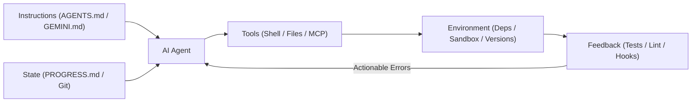

import PythonRunner from '../../../components/islands/PythonRunner';
import QuizCard from '../../../components/islands/QuizCard';
import ColabButton from '../../../components/static/ColabButton.astro';

People throw the word "harness" around a lot in AI coding circles, and most of the time they really just mean a prompt file. A prompt file is **not** a harness.

Think of dropping a newly hired engineer into a codebase with zero README, no comments, no test commands, and buried CI scripts. A human can eventually tap a colleague on the shoulder; an AI agent cannot. It only sees the files you put in front of it and the commands it can run. Formally, a harness $\mathcal{H}$ is the 5-tuple of engineering infrastructure surrounding the model weights:

$$
\mathcal{H} = \langle I, T, E, S, F \rangle
$$

where $I$ is **Instructions**, $T$ is **Tools**, $E$ is **Environment**, $S$ is **State**, and $F$ is **Feedback**.

---

## The 5-Subsystem Harness Model

| Subsystem | Responsibility | Concrete Artifacts | Google Antigravity Surface |
| :--- | :--- | :--- | :--- |
| **1. Instructions ($I$)** | Project overview, hard invariants, topic doc links | `AGENTS.md`, `GEMINI.md`, `.agents/rules/` | Hierarchical discovery + `20,000`-token `defaultRulesBudget` |
| **2. Tools ($T$)** | Least-privilege shell, file, search, and external APIs | `mcp_config.json`, `.agents/skills/` | Native tools + MCP Stdio/Streamable HTTP + `plugin.json` |
| **3. Environment ($E$)** | Self-describing, reproducible runtime & isolation | `pyproject.toml`, `.python-version`, `init.sh` | Standard Sandbox Mode + `workspace: "share"` / `"branch"` |
| **4. State ($S$)** | Cross-session memory, progress, and checkpoints | `PROGRESS.md`, `feature_list.json`, Git commits | Spec artifacts + `/compact` + transcript logs |
| **5. Feedback ($F$)** | Deterministic verification & highest-ROI checks | `pytest`, `mypy`, `ruff`, `.agents/hooks.json` | `PreToolUse`, `PostToolUse`, and `Stop` lifecycle hooks |

---

## Three Principles That Govern Every Subsystem

- **Give a map, not a manual**: Keep your root `AGENTS.md` to ~100 lines. Put deep module rules in `docs/` or `.agents/skills/` so the agent loads them on demand.
- **Constrain, don't micromanage**: Enforce invariants (*"all DB queries must be parameterized"*), not step-by-step code recipes. Separate the worker from the checker so the model never grades its own homework.
- **Controlled Variable Exclusion Tests**: Keep the model fixed and remove one subsystem at a time to measure its marginal contribution. Remember: ablation tells you *which component had the biggest drop*, while failure logs tell you *where the real bottleneck lives*.

A real React + TypeScript team proved this across four stages using the exact same model (GPT-4o): bare README (**20%** success) → added `AGENTS.md` (**60%**) → added explicit verification commands (**80%**) → added structured progress files (**80–100%**). Zero model upgrades required.

---

## Open the Companion Colab Notebook

Launch the companion notebook to run a **5-Subsystem Harness Audit** and a **Controlled Variable Exclusion Test** on a sample repository, with optional Gemini failure-attribution commentary.

<ColabButton
  course="harness-engineering"
  notebook="02-what-a-harness-actually-is.ipynb"
  runtime="Free Tier CPU"
/>

---

## Try It Yourself: 5-Subsystem Audit & Ablation Simulator

Execute this Python script to score a repository's five subsystems and observe how removing Feedback ($F$) or Instructions ($I$) impacts task pass rates.

<PythonRunner
  client:visible
  title="Try it Yourself: 5-Subsystem Ablation Simulator"
  expectedOutput="Full Harness Score: 23/25 -> Predicted Pass Rate: 90.0%
Exclusion Ablation Results:
  - Without Instructions (I): 66.0% (drop: -24.0%)
  - Without Feedback (F): 70.0% (drop: -20.0%)
  - Without State (S): 74.0% (drop: -16.0%)
  - Without Environment (E): 80.4% (drop: -9.6%)
  - Without Tools (T): 83.6% (drop: -6.4%)"
  initialCode={`subsystems = {
    "Instructions (I)": {"score": 5, "weight": 0.30},
    "Tools (T)": {"score": 4, "weight": 0.10},
    "Environment (E)": {"score": 4, "weight": 0.15},
    "State (S)": {"score": 5, "weight": 0.20},
    "Feedback (F)": {"score": 5, "weight": 0.25},
}

def predict_pass_rate(subs, excluded=None):
    total = 0.0
    for name, cfg in subs.items():
        s = 0 if name == excluded else cfg["score"]
        total += (s / 5.0) * cfg["weight"]
    return 0.14 + 0.80 * total  # baseline 14% + up to 80% from harness

full_score = sum(v["score"] for v in subsystems.values())
full_rate = predict_pass_rate(subsystems) * 100
print(f"Full Harness Score: {full_score}/25 -> Predicted Pass Rate: {full_rate:.1f}%")

print("Exclusion Ablation Results:")
drops = []
for name in subsystems:
    ablated = predict_pass_rate(subsystems, excluded=name) * 100
    drops.append((full_rate - ablated, name, ablated))

for drop, name, ablated in sorted(drops, reverse=True):
    print(f"  - Without {name}: {ablated:.1f}% (drop: -{drop:.1f}%)")`}
/>

---

## Check Your Understanding

<QuizCard
  client:visible
  question="In a Controlled Variable Exclusion Test, you remove the Feedback subsystem (verification commands) while keeping the model fixed, and pass rate drops by 40%. What does this prove—and what else do you still need?"
  options={[
    "It proves the model weights are corrupted and need fine-tuning.",
    "It quantifies Feedback's high marginal contribution for this task, though you still need failure logs to confirm whether Feedback is the primary bottleneck.",
    "It proves you should delete AGENTS.md and keep only pytest.",
    "It proves the Tools subsystem is completely unnecessary."
  ]}
  correctAnswer={1}
  explanation="Ablation quantifies each subsystem's marginal contribution on the current task, while failure attribution logs confirm the actual root-cause bottleneck."
/>
