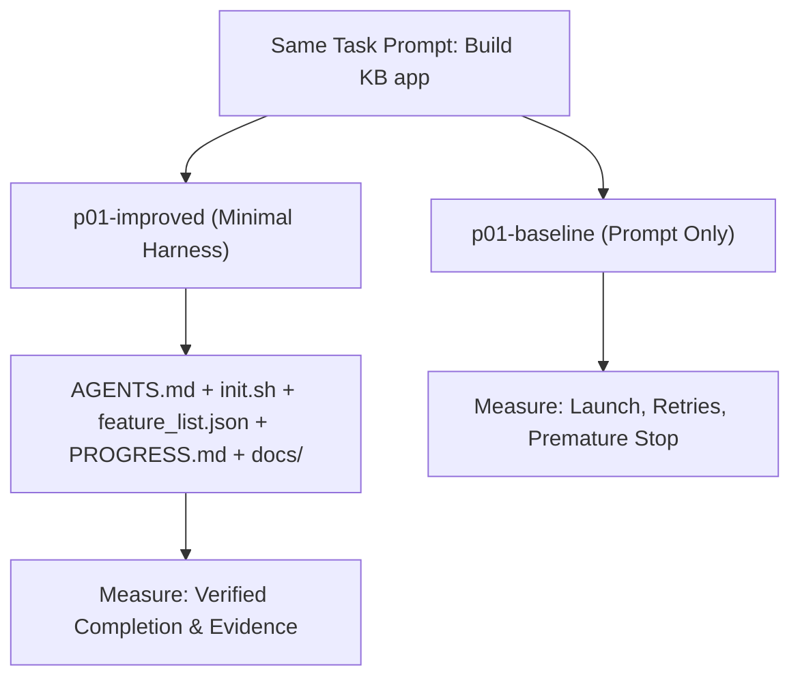

import PythonRunner from '../../../components/islands/PythonRunner';
import QuizCard from '../../../components/islands/QuizCard';
import ColabButton from '../../../components/static/ColabButton.astro';

Reading theory only takes you so far—now it is time to measure what happens when an AI coding agent builds real software with and without a harness. In **Project 01**, we build a **Python Knowledge Base Application Shell** with four concrete features:

1. **App Launch & Health Check** (`F01`): FastAPI/Gradio-ready app boots cleanly.
2. **Document List** (`F02`): Lists local Markdown/text documents from `./data/`.
3. **Question Panel** (`F03`): Accepts a user question and returns a grounded response.
4. **Local Data Directory Bootstrap** (`F04`): Automatically initializes `./data/` if missing.

---

## Experimental Protocol: Avoiding Cross-Contamination

A crucial rule for any harness experiment: **never run the weak-harness baseline and the strong-harness build as two git branches in the same working directory** if sibling files or reflogs are visible. Coding agents inspect everything they can reach; if the weak run spots `feature_list.json` or `docs/ARCHITECTURE.md`, your baseline is contaminated.

Instead, use two isolated directories (`p01-baseline/` vs. `p01-improved/`), running one at a time, archiving the logs and final diff, and deleting the temporary workspace before starting the second run. In Google Antigravity, you can achieve the same physical isolation using `invoke_subagent` with `workspace: "branch"`.

1. **First Run (Weak Harness — `p01-baseline/`)**: Give the agent only `task-prompt.md` (*"Build a Python Knowledge Base app that can list documents and answer questions"*). Provide no `AGENTS.md`, no `init.sh`, and no acceptance criteria. When the agent declares completion, run the launch command and record whether it actually boots without manual fixes.
2. **Second Run (Strong Harness — `p01-improved/`)**: Pre-place `AGENTS.md`, `GEMINI.md`, `init.sh`, `feature_list.json`, `PROGRESS.md`, and `docs/`. Reset all feature statuses to `not_started` and clear old session logs so the agent starts cleanly. Give the exact same prompt, then run `./init.sh` to verify.

---

## Minimal Harness Pack Artifacts & Evaluation Metrics

| Artifact | Purpose in `p01-improved/` | Reset Rule Before Run |
| :--- | :--- | :--- |
| `AGENTS.md` / `GEMINI.md` | Tech stack, layer boundaries, and `pytest` / `init.sh` commands | Keep active |
| `init.sh` | Reproducible bootstrap (`pip install -e . && pytest -q`) | Keep active |
| `feature_list.json` | 4 features (`F01`–`F04`) with executable verification commands | Reset all statuses to `not_started` |
| `PROGRESS.md` | Cross-session progress & evidence log | Clear old logs, keep header |
| `docs/ARCHITECTURE.md` | Boundary rules separating storage, service, and UI | Keep active |

Track five objective metrics across both runs: **Completion** (complete, partial, or failed), **Time to First Successful Launch**, **Human Retries Needed**, **Missing Features**, and **Premature Stop** (did the agent claim done while the app could not boot?). Even if the prompt-only run breaks, that broken output is valid experimental evidence proving why the harness matters.

---

## Open the Companion Colab Notebook

Launch the companion notebook to scaffold both `p01-baseline/` and `p01-improved/` in isolated temporary directories, run the Python Knowledge Base shell, and compare completion metrics with `google-genai` (`gemini-2.5-flash`).

<ColabButton
  course="harness-engineering"
  notebook="03-project-01-prompt-only-vs-rules-first-harness.ipynb"
  runtime="Free Tier CPU"
/>

---

## Try It Yourself: Knowledge Base Shell & Baseline vs. Harness Comparison

Run this self-contained Python Knowledge Base shell and comparison harness to verify all four features (`F01`–`F04`) and compare weak vs. strong harness metrics.

<PythonRunner
  client:visible
  title="Try it Yourself: Project 01 KB Shell & Harness Metrics"
  expectedOutput="[Weak Harness] Completed: 2/4 | Retries: 3 | Premature Stop: True
[Strong Harness] F01 Health: OK | F02 Docs: 2 | F03 Answer: Harness = I+T+E+S+F | F04 DataDir: Ready
[Strong Harness] Completed: 4/4 | Retries: 0 | Premature Stop: False"
  initialCode={`from dataclasses import dataclass

@dataclass
class RunMetrics:
    label: str
    completed: int
    total: int
    retries: int
    premature_stop: bool

weak = RunMetrics("Weak Harness", completed=2, total=4, retries=3, premature_stop=True)
print(f"[{weak.label}] Completed: {weak.completed}/{weak.total} | Retries: {weak.retries} | Premature Stop: {weak.premature_stop}")

# Minimal Python Knowledge Base Shell (F01-F04)
class KnowledgeBaseShell:
    def __init__(self, docs: dict[str, str]):
        self.data_dir_ready = True  # F04
        self.docs = docs            # F02

    def health(self) -> str:        # F01
        return "OK" if self.data_dir_ready else "ERR"

    def list_docs(self) -> list[str]:
        return sorted(self.docs.keys())

    def ask(self, question: str) -> str:  # F03
        for content in self.docs.values():
            if "Harness" in question and "Harness" in content:
                return content
        return "No matching document found."

kb = KnowledgeBaseShell({"01-intro.md": "Harness = I+T+E+S+F", "02-rules.md": "Repo is system of record"})
print(f"[Strong Harness] F01 Health: {kb.health()} | F02 Docs: {len(kb.list_docs())} | F03 Answer: {kb.ask('What is Harness?')} | F04 DataDir: Ready")

strong = RunMetrics("Strong Harness", completed=4, total=4, retries=0, premature_stop=False)
print(f"[{strong.label}] Completed: {strong.completed}/{strong.total} | Retries: {strong.retries} | Premature Stop: {strong.premature_stop}")`}
/>

---

## Check Your Understanding

<QuizCard
  client:visible
  question="Before running the Strong Harness experiment against a checked-in solution template, what must you reset in `feature_list.json` and `PROGRESS.md`?"
  options={[
    "Delete `AGENTS.md` and `init.sh` so the agent rediscovers them.",
    "Reset every feature status in `feature_list.json` to `not_started`, clear evidence/testedAt fields, and clear old session logs in `PROGRESS.md`.",
    "Leave all features marked `passing` so the agent finishes faster.",
    "Commit both baseline and improved folders into the same directory."
  ]}
  correctAnswer={1}
  explanation="If features remain marked `passing`, the agent sees nothing left to build. Resetting statuses to `not_started` and clearing old session logs keeps the experiment fair and reproducible."
/>
