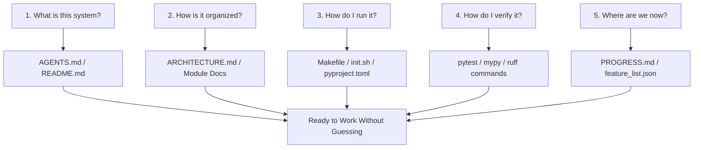

import QuizCard from '../../../components/islands/QuizCard';
import ColabButton from '../../../components/static/ColabButton.astro';

Your team's architecture decisions probably live across Slack threads, Jira tickets, Confluence pages, and a few senior engineers' heads. Humans can walk over to a teammate's desk and ask. An AI coding agent cannot. **Information that does not exist inside the repository literally does not exist for the agent.**

An agent only has three input channels: system/task prompts, files in the repository, and tool execution outputs. Everything outside the repo creates a **Knowledge Visibility Gap**—the fraction of project know-how the agent simply cannot see:

$$
G_{\text{vis}} = 1 - \frac{|K_{\text{repo}}|}{|K_{\text{total}}|}
$$

Here, $|K_{\text{repo}}|$ is the amount of project knowledge written down inside the repository, and $|K_{\text{total}}|$ is all the knowledge needed to work on the project safely. If half your team's rules live in Slack instead of Git, $G_{\text{vis}} = 0.50$—meaning the agent is flying blind 50% of the time, and every wrong guess becomes a bug or wasted context window.

---

## The 5-Question Fresh Session Test

How do you know if your repository is a true **System of Record**? Open a completely fresh agent session with zero verbal explanation and see if it can answer five questions from repo files alone:



---

## Proximity Beats Length + ACID Agent State

A 50-line `ARCHITECTURE.md` placed right inside `src/api/` beats a 500-page Confluence doc nobody maintains. Keep critical context close to the code (**low Discovery Cost**), keep it minimal yet complete, and update docs in the same commit as code changes so **Knowledge Decay Rate** stays near zero.

To keep repository state reliable across sessions and parallel agents, borrow **ACID** from database engineering:

| ACID Principle | Meaning for AI Agent State | Practical Implementation |
| :--- | :--- | :--- |
| **Atomicity** | Commit a logical unit only when complete & verified | Discard or roll back failed partial edits |
| **Consistency** | Every commit satisfies verification predicates | `pytest && mypy && ruff` pass before commit |
| **Isolation** | Concurrent agents never overwrite each other's state | Separate `PROGRESS` files or Google Antigravity `workspace: "share"` |
| **Durability** | Critical decisions survive session resets | Persist in Git-tracked `DECISIONS.md` & `AGENTS.md` |

---

## Open the Companion Colab Notebook

Launch the companion notebook to run an automated **5-Question Fresh Session Test** and **Knowledge Visibility Gap** audit across a sample repository, with optional Gemini (`gemini-2.5-flash`) gap-remediation suggestions.

<ColabButton
  course="harness-engineering"
  notebook="04-repository-as-system-of-record.ipynb"
  runtime="Free Tier CPU"
/>

---

## Try It Yourself: Fresh Session Test & Visibility Gap Auditor

Run this Python auditor to inspect a simulated repository, calculate $G_{\text{vis}}$, and identify which of the 5 Fresh Session questions remain unanswered.

**5-Question Fresh Session Auditor**

```python
def fresh_session_audit(repo_files: set[str]) -> tuple[float, list[str]]:
    checks = {
        "Q1 (System)": {"AGENTS.md", "README.md"},
        "Q2 (Architecture)": {"ARCHITECTURE.md", "src/api/ARCHITECTURE.md"},
        "Q3 (Run)": {"init.sh", "Makefile", "pyproject.toml"},
        "Q4 (Verify)": {"pytest.ini", "AGENTS.md"},
        "Q5 (Progress)": {"PROGRESS.md", "feature_list.json"},
    }
    # Require explicit dedicated verification & progress files for strict check
    strict_checks = {
        "Q1 (System)": "AGENTS.md" in repo_files or "README.md" in repo_files,
        "Q2 (Architecture)": any("ARCHITECTURE.md" in f for f in repo_files),
        "Q3 (Run)": "init.sh" in repo_files or "Makefile" in repo_files,
        "Q4 (Verify)": "tests/test_app.py" in repo_files,
        "Q5 (Progress)": "PROGRESS.md" in repo_files or "feature_list.json" in repo_files,
    }
    missing = [q for q, ok in strict_checks.items() if not ok]
    gap = len(missing) / len(strict_checks)
    return gap, missing

repo_a = {"README.md", "Makefile"}
gap_a, miss_a = fresh_session_audit(repo_a)
print(f"Repo A Visibility Gap: {gap_a:.2f} ({5 - len(miss_a)}/5 answered)")
print("  Missing:", ", ".join(miss_a))

repo_b = {"AGENTS.md", "src/api/ARCHITECTURE.md", "init.sh", "tests/test_app.py", "PROGRESS.md"}
gap_b, miss_b = fresh_session_audit(repo_b)
print(f"Repo B Visibility Gap: {gap_b:.2f} ({5 - len(miss_b)}/5 answered)")
print("  Fresh Session Test:", "PASSED" if not miss_b else "FAILED")
```

**Expected Output:**

```text
Repo A Visibility Gap: 0.60 (2/5 answered)
  Missing: Q2 (Architecture), Q4 (Verify), Q5 (Progress)
Repo B Visibility Gap: 0.00 (5/5 answered)
  Fresh Session Test: PASSED
```

---

## Check Your Understanding

<QuizCard
  client:visible
  question="Why is placing a 50-line `ARCHITECTURE.md` inside `src/api/` more effective for coding agents than maintaining a 500-page external Confluence wiki?"
  options={[
    "Agents cannot parse Markdown files longer than 100 lines.",
    "Agents cannot read Confluence without external connectors, and placing concise rules next to the code minimizes Discovery Cost and Knowledge Decay.",
    "Confluence blocks all automated git commits.",
    "Short files bypass unit testing requirements."
  ]}
  correctAnswer={1}
  explanation="Information outside the repository is invisible by default, and proximity to the module code reduces Discovery Cost while keeping docs synchronized with code edits."
/>
