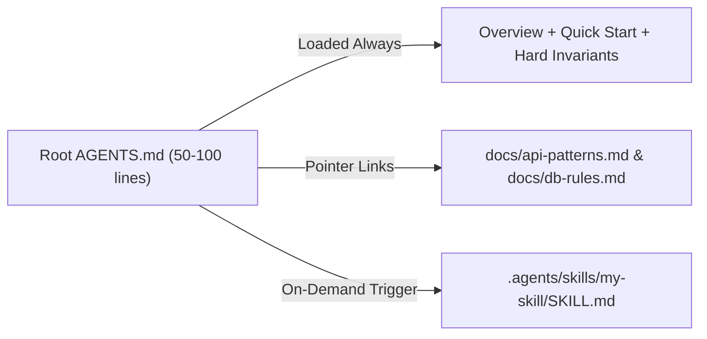

import QuizCard from '../../../components/islands/QuizCard';
import ColabButton from '../../../components/static/ColabButton.astro';

Once teams embrace `AGENTS.md`, they often fall into the **"add a rule" vicious cycle**: every time the agent makes a mistake, someone appends another rule. Three months later, `AGENTS.md` is 600 lines long, consumes 15,000 tokens of context, and the agent actually performs *worse*.

Why? Because of three measurable phenomena:
1. **Lost in the Middle (Liu et al., 2023)**: LLMs recall instructions at the beginning and end of a prompt far better than rules buried in the middle (like a security constraint at line 300).
2. **Low Instruction Signal-to-Noise Ratio ($\text{SNR}$)**: Think of this like trying to hear a friend in a noisy coffee shop—loading 50 lines of deployment rules during a CSS bug fix drowns out the instructions that actually matter for task $t$:

$$
\text{SNR}(t) = \frac{|I_{\text{relevant}}(t)|}{|I_{\text{loaded}}(t)|}
$$

Here, $|I_{\text{relevant}}(t)|$ is the number of loaded rules useful for the current task $t$, and $|I_{\text{loaded}}(t)|$ is the total volume of instructions stuffed into the context window.

3. **Contradiction & Bloat**: An ETH Zurich study showed bloated repository context files can raise inference cost by over 20% without improving success, whereas Lulla et al.'s paired study of concise `AGENTS.md` files on 124 tasks saw median runtime drop **28.64%** (98.57 s → 70.34 s) and output tokens drop **16.58%** (2,925 → 2,440).

---

## Map vs. Encyclopedia + Google Antigravity's Rules Budget



**Google Antigravity** enforces this architecture mechanically:
- **Per-File Cap (`24 KB` / `24,000` bytes)**: Any single `GEMINI.md` or `AGENTS.md` over 24,000 bytes is truncated on line boundaries.
- **Aggregate Rules Budget (`20,000` tokens `defaultRulesBudget`)**: Always-on and global rules share a 20,000-token budget. Over-budget rules are automatically demoted from inline text to **file-path pointers** so the agent reads them only when needed.
- **Progressive Disclosure Skills (`.agents/skills/<name>/SKILL.md`)**: Only the skill `name` and `description` are injected at startup; the full `SKILL.md` body and `references/` load only when triggered.
- **Lifecycle Metadata**: Every rule you keep should document its **source**, **applicability condition**, and **expiry condition** so stale rules get pruned like unused dependencies.

| Instruction Mechanism | Scope & Loading | Size / Budget Behavior | Best Used For |
| :--- | :--- | :--- | :--- |
| Root `AGENTS.md` / `GEMINI.md` | Always loaded at CWD → repo root | Keep 50–100 lines (`< 24 KB`) | Overview, test commands, $\le 15$ hard invariants |
| Subdirectory `AGENTS.md` | Hierarchical CWD → root | Deduplicated by file path | Module-specific constraints |
| `.agents/skills/<name>/SKILL.md` | On-demand Progressive Disclosure | Metadata-only until activated | Multi-step runbooks, scripts, references |
| `docs/*.md` topic files | Read on demand via pointer links | Zero startup token tax | Deep API, DB, and deployment guides |

---

## Open the Companion Colab Notebook

Launch the companion notebook to calculate Instruction $\text{SNR}$, simulate Google Antigravity's `24 KB` cap and `20,000`-token `defaultRulesBudget` pointer demotion, and test Progressive Disclosure skill routing.

<ColabButton
  course="harness-engineering"
  notebook="05-splitting-instructions-and-progressive-disclosure.ipynb"
  runtime="Free Tier CPU"
/>

---

## Try It Yourself: Instruction SNR & Antigravity Budget Simulator

Run this Python simulator to compare a 600-line monolithic `AGENTS.md` against a modular 80-line router + on-demand `SKILL.md` setup.

**Instruction SNR & Antigravity Budget Check**

```python
def calc_snr(relevant_lines: int, loaded_lines: int) -> float:
    return relevant_lines / loaded_lines

mono_snr = calc_snr(relevant_lines=72, loaded_lines=600)
mod_snr = calc_snr(relevant_lines=90, loaded_lines=80 + 50)  # 80-line router + 50-line triggered skill

print(f"Monolithic AGENTS.md: 600 lines | Task SNR: {mono_snr:.2f} ({mono_snr*100:.1f}%)")
print(f"Modular Router + Skill: 130 lines | Task SNR: {mod_snr:.2f} ({mod_snr*100:.1f}%)")

MAX_FILE_BYTES = 24_000
files = [("root AGENTS.md", 3200), ("legacy-dump.md", 26500)]
print("Budget Check (24KB cap / 20k tokens):")
for name, size in files:
    status = "INLINE" if size <= MAX_FILE_BYTES else "TRUNCATED (>24KB cap)"
    print(f"  - {name} ({size} bytes): {status}")
```

**Expected Output:**

```text
Monolithic AGENTS.md: 600 lines | Task SNR: 0.12 (12.0%)
Modular Router + Skill: 130 lines | Task SNR: 0.69 (69.2%)
Budget Check (24KB cap / 20k tokens):
  - root AGENTS.md (3200 bytes): INLINE
  - legacy-dump.md (26500 bytes): TRUNCATED (>24KB cap)
```

---

## Check Your Understanding

<QuizCard
  client:visible
  question="How does Google Antigravity prevent a repository's always-on rules from exhausting the model's context window?"
  options={[
    "It deletes all rules older than 7 days.",
    "It enforces a 24 KB per-file cap and a 20,000-token aggregate `defaultRulesBudget` (demoting overflow rules to file-path pointers), while loading `.agents/skills/*/SKILL.md` via progressive disclosure.",
    "It merges all rules into a single 1,000-line system prompt.",
    "It ignores `AGENTS.md` files in subdirectories."
  ]}
  correctAnswer={1}
  explanation="Antigravity caps individual rule files at 24 KB, enforces a 20,000-token aggregate budget with pointer demotion, and uses progressive disclosure for Skills so full instructions load only when relevant."
/>
