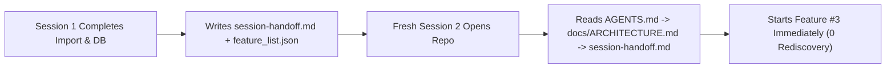

import QuizCard from '../../../components/islands/QuizCard';
import ColabButton from '../../../components/static/ColabButton.astro';

In Project 01, our Knowledge Base shell booted and answered simple questions from memory. Now in **Project 02**, we add three real product features across two simulated agent sessions:

1. **Document Import**: Ingest Markdown/text files into the Knowledge Base.
2. **Full Document Detail View**: Retrieve complete document content and metadata by ID.
3. **SQLite Persistence Across Restarts**: Store documents in `kb.sqlite` so data survives process restarts.

The real test isn't just whether the SQLite queries work—it is whether a **brand-new agent session** can read your workspace and resume work with zero verbal explanation.

---

## Starter (Thin Docs) vs. Solution (Agent-Readable Workspace)

Why does this matter in practice? In the **starter** workspace, `AGENTS.md` is a thin 10-line summary and `session-handoff.md` does not exist. When Session 2 opens, the agent has to read every Python file in `src/` just to discover whether documents are stored in JSON or SQLite, what schema columns exist, and which features are already finished. That rediscovery burns thousands of tokens and frequently introduces conflicting database code.

In the **solution** workspace, we turn the repository into an agent-readable map:
- `AGENTS.md` stays short (~60 lines) and routes the agent to `docs/ARCHITECTURE.md` and `docs/PRODUCT.md`.
- `docs/ARCHITECTURE.md` documents the exact `docs` SQLite table schema (`id`, `title`, `body`), module boundaries, and `pytest` verification command.
- `session-handoff.md` records the latest Git commit, passing test count, completed features, and the exact next action for Session 2.



| Workspace Artifact | Starter (Weak Readability) | Solution (Agent-Readable) |
| :--- | :--- | :--- |
| `AGENTS.md` | 10-line generic note | Concise router pointing to `docs/ARCHITECTURE.md` & `docs/PRODUCT.md` |
| `docs/ARCHITECTURE.md` | Missing or outdated | Exact SQLite schema, module boundaries, and test commands |
| `session-handoff.md` | Missing | Current commit, passing tests, active blocker, and exact next step |
| `feature_list.json` | Missing | Tracks `import`, `detail-view`, and `sqlite-persistence` states |

By the way, notice how cleanly this connects to the **5-Question Fresh Session Test** from Lesson 04: any brand-new Google Antigravity session opening `p02-solution/` can answer *what this system is, how it is organized, how to run it, how to verify it, and where work left off* in under 30 seconds without asking you a single question.

---

## Open the Companion Colab Notebook

Launch the companion notebook to run the full **SQLite Knowledge Base** (import, detail view, restart persistence) and test whether a fresh `google-genai` session can answer all 5 Fresh Session questions from `session-handoff.md` alone.

<ColabButton
  course="harness-engineering"
  notebook="06-project-02-agent-readable-workspace-and-handoffs.ipynb"
  runtime="Free Tier CPU"
/>

---

## Try It Yourself: SQLite KB Persistence & Handoff Reader

Execute this Python script to create an in-memory SQLite Knowledge Base, import two documents, fetch full detail view, and verify a structured `session-handoff.md` payload.

**Project 02 SQLite KB & Handoff**

```python
import sqlite3

conn = sqlite3.connect(":memory:")
conn.execute("CREATE TABLE docs (id TEXT PRIMARY KEY, title TEXT, body TEXT)")

def import_doc(doc_id: str, title: str, body: str):
    conn.execute("INSERT OR REPLACE INTO docs VALUES (?, ?, ?)", (doc_id, title, body))
    conn.commit()

def get_doc_detail(doc_id: str) -> tuple[str, str]:
    row = conn.execute("SELECT title, body FROM docs WHERE id = ?", (doc_id,)).fetchone()
    return row if row else ("", "")

import_doc("doc-1", "Harness Engineering", "The repo is the system of record.")
import_doc("doc-2", "Antigravity Rules", "Keep root AGENTS.md under 24 KB.")
print(f"Imported {conn.execute('SELECT COUNT(*) FROM docs').fetchone()[0]} docs into SQLite KB.")

title, body = get_doc_detail("doc-1")
print(f"Detail View [doc-1]: {title} -> {body}")
print(f"Restart Persistence Check: {conn.execute('SELECT COUNT(*) FROM docs').fetchone()[0]} docs survived.")

handoff = {"completed": ["import", "detail_view", "sqlite_persistence"], "next_action": "Implement chunking in Project 03"}
print(f"Handoff Next Action: {handoff['next_action']}")
```

**Expected Output:**

```text
Imported 2 docs into SQLite KB.
Detail View [doc-1]: Harness Engineering -> The repo is the system of record.
Restart Persistence Check: 2 docs survived.
Handoff Next Action: Implement chunking in Project 03
```

---

## Check Your Understanding

<QuizCard
  client:visible
  question="What is the primary purpose of `session-handoff.md` in Project 02?"
  options={[
    "To store raw binary SQLite database backups.",
    "To let a completely fresh agent session reconstruct repo state, verified test status, and the exact next task without any verbal context from a human.",
    "To replace `AGENTS.md` with a 500-line chat transcript.",
    "To disable unit tests between sessions."
  ]}
  correctAnswer={1}
  explanation="`session-handoff.md` bridges session boundaries so a fresh session immediately knows what is verified, what failed, and what to execute next."
/>
