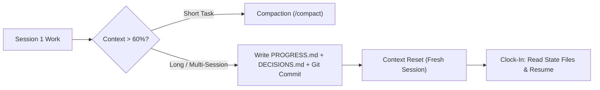

import QuizCard from '../../../components/islands/QuizCard';
import ColabButton from '../../../components/static/ColabButton.astro';

You ask an agent to build a complete authentication module. It works for thirty minutes, writes solid code, and then hits the context window limit. You open a fresh session to finish the last 20%—and immediately watch the new session spend fifteen minutes re-exploring the codebase, wondering why Redis was chosen over PostgreSQL, and overwriting a deliberate design choice.

Context windows are finite, and larger windows alone do not solve this. Why? Because intermediate reasoning holds the **"why"** (rejected alternatives, edge-case constraints), while source files only hold the **"what."** Worse, Anthropic observed a failure mode they call **Context Anxiety**: when agents sense their context budget running low, they rush to finish, skip verification steps, and settle for inferior shortcuts.

---

## Compaction vs. Context Reset



| Strategy | How It Works | Preserves "What" | Preserves "Why" | Cures Context Anxiety? |
| :--- | :--- | :--- | :--- | :--- |
| **Compaction (`/compact` in Antigravity)** | Summarizes older turns inside the same session | Yes | Partially (often pruned) | No—model knows context was large |
| **Context Reset + State Files** | Clears window completely and rebuilds from disk | Yes (via Git & code) | Yes (via `DECISIONS.md`) | **Yes**—fresh mental state |

Anthropic's experiments showed that Sonnet 4.5 needed full **context resets** to eliminate Context Anxiety, whereas Opus 4.5 handled compaction much better. The takeaway for harness engineers: **tune your continuity strategy to the model, not a one-size-fits-all template.** Meanwhile, LangChain reported that adding structured context management, verification guidance, and middleware on Terminal Bench 2.0 (89 tasks) lifted the exact same `gpt-5.2-codex` model from **52.8% to 66.5%** (+13.7 percentage points).

---

## The 4 State Persistence Tools & Clock-In / Clock-Out Routine

Treat every agent like an engineer whose short-term memory resets between shifts:
1. **`PROGRESS.md`**: Current commit hash, passing/failing test counts, active work, known blockers, and next steps.
2. **`DECISIONS.md`**: Lightweight Architecture Decision Records (*what was chosen, why, and what alternative was rejected*).
3. **Atomic Git Checkpoints**: Commit after each verified unit so `git log` acts as a versioned state snapshot.
4. **Clock-In / Clock-Out Protocol** in `AGENTS.md`: Start every session by reading `PROGRESS.md` and `DECISIONS.md` and running `make check`; end every session by updating `PROGRESS.md` and committing. Prepare a handoff whenever a task crosses **60% of the context window**.

---

## Open the Companion Colab Notebook

Launch the companion notebook to simulate **Rebuild Cost** with and without `PROGRESS.md` / `DECISIONS.md`, serialize structured session handoffs, and summarize transcripts via Gemini (`gemini-2.5-flash`).

<ColabButton
  course="harness-engineering"
  notebook="07-multi-session-continuity-and-context-anxiety.ipynb"
  runtime="Free Tier CPU"
/>

---

## Try It Yourself: Rebuild Cost & Context Anxiety Simulator

Run this Python script to compare session **Rebuild Cost** (tokens burned re-discovering project state) and **Context Anxiety** risk between an unpersisted session and a clock-in/clock-out harness.

**Session Rebuild Cost Simulator**

```python
def simulate_session_start(has_progress_file: bool, has_decisions_log: bool) -> tuple[int, bool]:
    if not has_progress_file and not has_decisions_log:
        return 18500, True  # Re-reads entire repo & guesses prior trade-offs
    rebuild_tokens = 700 if has_progress_file else 9000
    rebuild_tokens += 500 if has_decisions_log else 4000
    drift = not has_decisions_log
    return rebuild_tokens, drift

cost_bare, drift_bare = simulate_session_start(False, False)
print(f"Without State Files -> Rebuild Cost: {cost_bare} tokens | Decision Drift: {drift_bare}")

cost_good, drift_good = simulate_session_start(True, True)
print(f"With PROGRESS.md + DECISIONS.md -> Rebuild Cost: {cost_good} tokens | Decision Drift: {drift_good}")

used, limit = 125_000, 200_000
ratio = used / limit
action = "PREPARE HANDOFF" if ratio >= 0.60 else "CONTINUE"
print(f"60% Context Trigger ({used}/{limit} = {ratio*100:.1f}%): {action}")
```

**Expected Output:**

```text
Without State Files -> Rebuild Cost: 18500 tokens | Decision Drift: True
With PROGRESS.md + DECISIONS.md -> Rebuild Cost: 1200 tokens | Decision Drift: False
60% Context Trigger (125000/200000 = 62.5%): PREPARE HANDOFF
```

---

## Check Your Understanding

<QuizCard
  client:visible
  question="Why does a full Context Reset (paired with `PROGRESS.md` and `DECISIONS.md`) often outperform in-session Compaction on very long tasks?"
  options={[
    "Compaction deletes all Git commits in the repository.",
    "Compaction often drops the 'why' behind past decisions and leaves the agent with Context Anxiety, whereas a Context Reset gives a fresh window rebuilt from durable state files.",
    "Context Reset increases the model's parameter count.",
    "Compaction only works on JavaScript repositories."
  ]}
  correctAnswer={1}
  explanation="Compaction summarizes prior turns (often losing decision rationale) and does not always clear Context Anxiety, whereas a Context Reset starts clean from explicit `PROGRESS.md` and `DECISIONS.md` files."
/>
