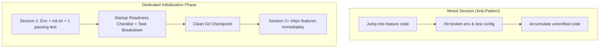

import QuizCard from '../../../components/islands/QuizCard';
import ColabButton from '../../../components/static/ColabButton.astro';

When you open a new project and tell an agent *"add a search feature,"* it eagerly jumps straight into writing routes and UI components. Twenty minutes later it discovers the test runner is misconfigured, spends ten minutes fighting `pytest` imports, and leaves half-wired feature code behind.

The root cause is **mixing initialization with implementation**. Those two phases have conflicting optimization targets: implementation optimizes for shipping verified features, while initialization optimizes for making *every future session* fast, deterministic, and verifiable.

---

## Why Mixing Them Backfires



When you mix them, you get **unverified accumulation** (broken architecture written before tests even work) and **implicit assumption landmines** (Session 1 picks `unittest`, Session 2 introduces `pytest`). By contrast, a dedicated initialization phase—starting from a clean template rather than an empty folder—cuts total cross-session rebuild time by roughly **60%**.

---

## The 5 Initialization Outputs & Antigravity `SessionStart`

A dedicated initialization session writes **zero business feature code**. Instead, it produces five infrastructure artifacts:
1. **Runnable environment** (`init.sh` / `pyproject.toml` verified from scratch).
2. **At least one passing example test** proving the test harness works.
3. **Startup Readiness Checklist** answering: *can start, can test, can see progress, can pick up next steps*.
4. **Ordered Task Breakdown** with explicit acceptance criteria (`feature_list.json`).
5. **Clean Git checkpoint** so Session 2 starts on solid ground.

By the way, starting from a **standardized project template** beats starting from an empty directory every single time. When directory structure, dependency locking, and `pytest` configuration are already baked into the template, the initializer session only has to wire project-specific checks and write the task breakdown. Measure your initialization quality with two metrics: **Time from Start to First Passing Test** and **Success Rate of Subsequent Sessions** (how often Session 2+ runs cleanly without human rescue).

In **Google Antigravity**, you can enforce initialization checks automatically at the start of every new conversation using a **`SessionStart` hook** in `.agents/hooks.json`:

| Hook Event | When It Fires | Payload Output (`stdout`) | Initialization Use Case |
| :--- | :--- | :--- | :--- |
| `SessionStart` | Once per new session | `{"injectSteps": [{"systemMessage": {"systemMessage": "..."}}]}` | Inject `PROGRESS.md` status & verify `init.sh` |

---

## Open the Companion Colab Notebook

Launch the companion notebook to run an automated **Initialization Acceptance Checklist** and test a cross-platform Python `SessionStart` hook handler.

<ColabButton
  course="harness-engineering"
  notebook="08-dedicated-initialization-phase.ipynb"
  runtime="Free Tier CPU"
/>

---

## Try It Yourself: Initialization Checklist & `SessionStart` Hook

Execute this Python script to validate the 5 Initialization Acceptance conditions and emit a valid Google Antigravity `SessionStart` JSON payload.

**Initialization Gate & SessionStart Hook**

```python
import json

init_checks = {
    "setup_succeeds": True,
    "example_test_passes": True,
    "fresh_session_readable": True,
    "task_breakdown_ready": True,
    "git_checkpoint_committed": True,
}

passed = sum(init_checks.values())
status = "PASSED" if passed == len(init_checks) else "FAILED"
print(f"Initialization Acceptance: {status} ({passed}/{len(init_checks)} checks)")

hook_response = {
    "injectSteps": [
        {
            "systemMessage": {
                "systemMessage": "Init verified: 1/1 smoke test passing. Continue from F01."
            }
        }
    ]
}
print("SessionStart Hook Output:", hook_response)
```

**Expected Output:**

```text
Initialization Acceptance: PASSED (5/5 checks)
SessionStart Hook Output: {'injectSteps': [{'systemMessage': {'systemMessage': 'Init verified: 1/1 smoke test passing. Continue from F01.'}}]}
```

---

## Check Your Understanding

<QuizCard
  client:visible
  question="What should the output of a Dedicated Initialization Phase be?"
  options={[
    "At least 50% of the business feature endpoints.",
    "Purely infrastructure: a runnable environment, one passing smoke test, a Startup Readiness Checklist, an ordered task breakdown, and a clean Git checkpoint.",
    "A 400-line `AGENTS.md` containing every future feature's code.",
    "Disabling Git commits until the entire app is finished."
  ]}
  correctAnswer={1}
  explanation="Initialization and implementation have different goals. Dedicated initialization builds reliable, verifiable infrastructure so every subsequent session can ship features safely."
/>
