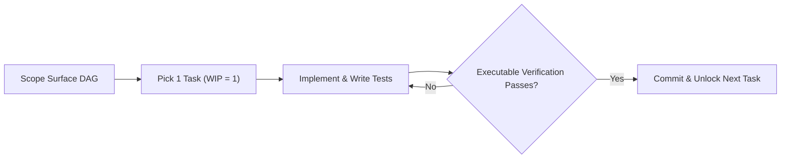

import PythonRunner from '../../../components/islands/PythonRunner';
import QuizCard from '../../../components/islands/QuizCard';
import ColabButton from '../../../components/static/ColabButton.astro';

You ask an agent to *"add user registration,"* and two hours later you find 12 modified files and 800 lines of code: a User model, a half-wired mail service, a refactored global error handler, and a reorganized test folder—with **zero features working end-to-end**.

This is **Overreach** paired with **Under-finish**, and it comes down to simple math. If an agent's effective reasoning capacity is $C$ and it activates $k$ tasks at once, each task receives $C / k$ attention. Once $C / k$ falls below the threshold needed to finish and verify one task, *all $k$ tasks stall half-done*. By Little's Law ($L = \lambda \cdot W$), raising Work-in-Progress $L$ inflates cycle time $W$ for every feature.

---

## Enforcing $\text{WIP} = 1$ on the Scope Surface

Track **Verified Completion Rate ($\text{VCR}$)**:

$$
\text{VCR} = \frac{N_{\text{verified passing}}}{N_{\text{activated}}}
$$

Block any new task activation whenever $\text{VCR} < 1.0$. Why? Because humans have a natural intuition for *"I've bitten off enough,"* whereas generating the next *"while I'm here, let me also refactor..."* edit costs an LLM almost zero tokens—yet silently fractures attention across five half-finished threads.

In a real 8-feature REST API comparison:
- **Unconstrained Mode ($\text{WIP} = 5$)**: 1,200 lines of code across 12 files, **37.5%** (3/8) features completed by Session 3.
- **$\text{WIP} = 1$ Mode**: 800 lines of tighter code, **87.5%** (7/8) features verified passing end-to-end by Session 4.

Notice the pattern: **"do less but finish" always beats "do more but leave half-done."** Total lines of code and feature completion rate are often negatively correlated when an agent lacks scope discipline.

| Concept | Definition | Harness Rule |
| :--- | :--- | :--- |
| **Overreach** | Activating more tasks than attention budget supports | Reject multi-feature edits in one turn |
| **Under-finish** | Writing code without passing end-to-end checks | Require executable Completion Evidence |
| **Scope Surface** | DAG of work units (`not_started`, `active`, `blocked`, `passing`) | Externalize in JSON/Markdown |
| **Completion Pressure** | Constraint forcing completion before starting next task | Block next task if $\text{VCR} < 1.0$ |

---

## Open the Companion Colab Notebook

Launch the companion notebook to build a **Scope Surface DAG** scheduler that enforces $\text{WIP} = 1$, blocks new activations when $\text{VCR} < 1.0$, and unlocks dependent tasks only after executable verification passes.

<ColabButton
  course="harness-engineering"
  notebook="09-task-boundaries-and-wip-limits.ipynb"
  runtime="Free Tier CPU"
/>

---

## Try It Yourself: $\text{WIP} = 1$ Scheduler & VCR Guard

Run this Python script to compare $\text{WIP} = 5$ overreach against strict $\text{WIP} = 1$ scheduling.

<PythonRunner
  client:visible
  title="Try it Yourself: WIP=1 Scope Guard & VCR Calculator"
  expectedOutput="Unconstrained (WIP=5): VCR = 0.20 (1/5 verified) -> BLOCKED
Strict WIP=1: Activated F01 -> Verified -> VCR = 1.00 (1/1) -> Ready for F02"
  initialCode={`def vcr(verified: int, activated: int) -> float:
    return verified / activated if activated else 1.0

# Unconstrained run: 5 tasks started, only 1 verified
wip5_vcr = vcr(verified=1, activated=5)
print(f"Unconstrained (WIP=5): VCR = {wip5_vcr:.2f} (1/5 verified) -> {'OK' if wip5_vcr == 1.0 else 'BLOCKED'}")

# Strict WIP=1 run
active_tasks = ["F01"]
verified_tasks = ["F01"]
wip1_vcr = vcr(len(verified_tasks), len(active_tasks))
next_action = "Ready for F02" if wip1_vcr == 1.0 else "Finish F01 first"
print(f"Strict WIP=1: Activated F01 -> Verified -> VCR = {wip1_vcr:.2f} (1/1) -> {next_action}")`}
/>

---

## Check Your Understanding

<QuizCard
  client:visible
  question="Why is `WIP = 1` the safest default for AI coding agent harnesses?"
  options={[
    "Because agents cannot edit more than one file per hour.",
    "Because activating multiple features simultaneously divides finite reasoning capacity C/k, increasing cycle time and leaving features half-done without end-to-end verification.",
    "Because Git only supports one commit per day.",
    "Because unit tests fail when two features exist in the same repo."
  ]}
  correctAnswer={1}
  explanation="By attention math (C/k) and Little's Law, finishing and verifying one feature before activating the next maximizes Verified Completion Rate (VCR)."
/>
