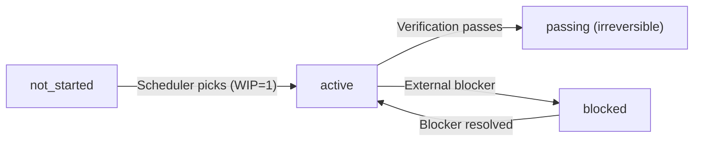

import QuizCard from '../../../components/islands/QuizCard';
import ColabButton from '../../../components/static/ColabButton.astro';

Most teams treat a feature list like a human scratchpad: jot down a few bullet points, hand them to an agent, and toss the list aside. When the agent finishes, it proudly announces *"done!"*—and you open the app only to find the login page works while the checkout button is a dead stub.

In harness engineering, a feature list is **not** a memo for humans. It is a **machine-enforced primitive**—like a database constraint—that four harness subsystems depend on:
1. **Scheduler**: Reads `not_started` items and picks the next $\text{WIP} = 1$ task.
2. **Verifier**: Executes the item's verification command and controls state transitions.
3. **Handoff Reporter**: Generates `session-handoff.md` directly from verified states.
4. **Progress Tracker**: Computes remaining **Back-Pressure** ($B = N_{\text{total}} - N_{\text{passing}}$)—think of it like water pressure behind a dam: the exact count of unfinished features still waiting to pass verification.

---

## The Feature Triple & Pass-State Gating

Every row in `feature_list.json` must contain a **Triple**: `(behavior, verification, state)`.



**Pass-State Gating** is the golden rule: **the coding agent is never allowed to set `state = "passing"` itself.** It can only request verification; the harness executes the verification command and promotes `active → passing` only when the command exits with code `0` and attaches commit/log evidence.

Just as important is **calibrating granularity** so each row is completable inside a single session. *"Implement the shopping cart"* is too broad (it invites overreach), while *"Add a `name` column to Cart"* is too narrow (management overhead swamps real work). *"User can add an item to cart and see the updated total"* hits the sweet spot. Once every item in `feature_list.json` reaches `passing`, Back-Pressure drops to zero and the project is verifiably done.

| Field | Purpose | Good Granularity Example |
| :--- | :--- | :--- |
| `id` | Unique stable identifier | `"F03"` |
| `behavior` | Single-session end-to-end user behavior | `"POST /cart/items returns 201 with updated total"` |
| `verification` | Executable command proving behavior | `"pytest tests/test_cart.py -k test_add_item"` |
| `state` | Controlled state machine value | `"not_started" \| "active" \| "blocked" \| "passing"` |
| `evidence` | Immutable proof attached by verifier | `"commit abc123, pytest 1/1 passed"` |

---

## Open the Companion Colab Notebook

Launch the companion notebook to run a full `feature_list.json` **Pass-State Gate** engine that blocks self-promotion and drives a session-sized task queue to zero back-pressure.

<ColabButton
  course="harness-engineering"
  notebook="10-feature-lists-as-harness-primitives.ipynb"
  runtime="Free Tier CPU"
/>

---

## Try It Yourself: Pass-State Gate Engine

Run this Python state machine to see how Pass-State Gating blocks an unverified `passing` transition and promotes a feature only after its verification check succeeds.

**Feature List Pass-State Gate**

```python
class FeatureGate:
    def __init__(self, features: list[dict]):
        self.features = {f["id"]: f for f in features}

    def agent_attempt_pass(self, fid: str) -> str:
        return f"[Agent Self-Mark Attempt] {fid} -> BLOCKED (requires verifier exit_code == 0)"

    def verify_and_promote(self, fid: str, check_fn) -> str:
        f = self.features[fid]
        if f["state"] != "active":
            return f"[Harness Verifier] {fid} must be active first"
        if check_fn():
            f["state"] = "passing"
            f["evidence"] = "verifier_exit_0"
            return f"[Harness Verifier] {fid} check passed -> Promoted to 'passing'"
        return f"[Harness Verifier] {fid} failed -> Remains 'active'"

    def back_pressure(self) -> tuple[int, int]:
        remaining = sum(1 for f in self.features.values() if f["state"] != "passing")
        return remaining, len(self.features)

gate = FeatureGate([
    {"id": "F01", "behavior": "Import doc", "state": "active", "evidence": ""},
    {"id": "F02", "behavior": "Query doc", "state": "not_started", "evidence": ""},
])
print(gate.agent_attempt_pass("F01"))
print(gate.verify_and_promote("F01", lambda: True))
rem, tot = gate.back_pressure()
print(f"Remaining Back-Pressure: {rem}/{tot} features left")
```

**Expected Output:**

```text
[Agent Self-Mark Attempt] F01 -> BLOCKED (requires verifier exit_code == 0)
[Harness Verifier] F01 check passed -> Promoted to 'passing'
Remaining Back-Pressure: 1/2 features left
```

---

## Check Your Understanding

<QuizCard
  client:visible
  question="What does 'Pass-State Gating' enforce in `feature_list.json`?"
  options={[
    "The coding agent can mark any feature `passing` as soon as it finishes writing code.",
    "Only the harness verifier can transition a feature from `active` to `passing`, and only after its executable verification command succeeds.",
    "Features automatically reset from `passing` to `not_started` every hour.",
    "Verification commands are optional if the description is long enough."
  ]}
  correctAnswer={1}
  explanation="Pass-State Gating removes self-grading: the agent cannot mark a feature passing; only an executable verification run controlled by the harness can promote the state."
/>
