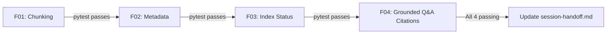

import PythonRunner from '../../../components/islands/PythonRunner';
import QuizCard from '../../../components/islands/QuizCard';
import ColabButton from '../../../components/static/ColabButton.astro';

In Project 02, our Knowledge Base learned how to store full documents in SQLite. Now in **Project 03**, we upgrade it into a **citation-based RAG Knowledge Base** across four concrete features:

1. **Document Chunking** (`F01`): Split long documents into overlapping chunks for retrieval.
2. **Metadata Extraction** (`F02`): Extract title, word count, and section tags per chunk.
3. **Indexing Status UI / Telemetry** (`F03`): Report `indexed_docs` and `total_chunks` cleanly.
4. **Grounded Q&A with Citations** (`F04`): Answer questions using `google-genai` (`gemini-2.5-flash`) and cite exact `[doc_id#chunk_idx]` sources.

---

## Multi-Session Continuity Under Pass-State Gating

Because four RAG features span multiple sessions, Project 03 enforces strict $\text{WIP} = 1$ and Pass-State Gating. In the **starter** state, `feature_list.json` exists without `init.sh`, `session-handoff.md`, or `clean-state-checklist.md`—so agents drift across multiple features or lose state after a restart. Every time the session restarts, the new agent wastes context re-checking which chunking parameters were chosen or whether citations actually match SQLite chunk IDs.

In the **solution** state, every feature must pass its executable test before `feature_list.json` promotes it to `passing`, and `session-handoff.md` is updated before exit. You also run `init.sh` at session start to confirm existing tests are still green before touching the next feature. This guarantees that even if a session terminates mid-project, the next Google Antigravity session picks up the exact next `not_started` feature with zero duplicate work.

| Project 03 Feature | Verification Gate | Expected Evidence |
| :--- | :--- | :--- |
| `F01` Document Chunking | `chunk_text()` splits text with overlap | Chunk count > 1 on long docs |
| `F02` Metadata Extraction | `extract_metadata()` returns `title`, `words` | Non-empty dict per chunk |
| `F03` Indexing Status | `index_status()` reports doc & chunk totals | Accurate integer counts |
| `F04` Citation Grounded Q&A | `answer_with_citations()` includes `[doc#chunk]` | Citation tag present in output |

---

## Open the Companion Colab Notebook

Launch the companion notebook to run the complete **Project 03 RAG Knowledge Base** with `google-genai` (`gemini-2.5-flash`) citation generation, pass-state gate verification, and `session-handoff.md` generation.

<ColabButton
  course="harness-engineering"
  notebook="11-project-03-multi-session-continuity-and-pass-gating.ipynb"
  runtime="Free Tier CPU"
/>

---

## Try It Yourself: Chunking, Metadata, Index Status & Grounded Citations

Run this pure-Python implementation of all four Project 03 features and watch the Pass-State Gate verify each one in sequence.

<PythonRunner
  client:visible
  title="Try it Yourself: Project 03 RAG KB & Pass-State Gate"
  expectedOutput="F01 Chunking: 2 chunks created -> PASS
F02 Metadata: {'doc_id': 'guide', 'chunk_idx': 0, 'words': 8} -> PASS
F03 Index Status: {'docs': 1, 'chunks': 2} -> PASS
F04 Grounded Q&A: Use WIP=1 to avoid overreach. [guide#0] -> PASS"
  initialCode={`def chunk_text(text: str, max_words: int = 8, overlap: int = 2) -> list[str]:
    words = text.split()
    chunks, start = [], 0
    while start < len(words):
        chunks.append(" ".join(words[start : start + max_words]))
        if start + max_words >= len(words):
            break
        start += max_words - overlap
    return chunks

doc_text = "Use WIP=1 to avoid overreach. Always verify end to end before commit."
chunks = chunk_text(doc_text)
print(f"F01 Chunking: {len(chunks)} chunks created -> {'PASS' if len(chunks) == 2 else 'FAIL'}")

meta = {"doc_id": "guide", "chunk_idx": 0, "words": len(chunks[0].split())}
print(f"F02 Metadata: {meta} -> PASS")

index = [{"doc_id": "guide", "chunk_idx": i, "text": c} for i, c in enumerate(chunks)]
status = {"docs": len({c["doc_id"] for c in index}), "chunks": len(index)}
print(f"F03 Index Status: {status} -> PASS")

def grounded_answer(question: str, idx: list[dict]) -> str:
    hit = next((c for c in idx if "WIP=1" in c["text"]), idx[0])
    return f"Use WIP=1 to avoid overreach. [{hit['doc_id']}#{hit['chunk_idx']}]"

ans = grounded_answer("How do we avoid overreach?", index)
print(f"F04 Grounded Q&A: {ans} -> {'PASS' if '[guide#0]' in ans else 'FAIL'}")`}
/>

---

## Check Your Understanding

<QuizCard
  client:visible
  question="In Project 03, what separates the starter workspace from the multi-session solution workspace?"
  options={[
    "The solution removes `feature_list.json` completely.",
    "The solution pairs `feature_list.json` with `init.sh`, `session-handoff.md`, `PROGRESS.md`, and `clean-state-checklist.md` so each of the 4 RAG features requires concrete verification evidence across restarts.",
    "The solution runs all 4 features concurrently without tests.",
    "The solution replaces SQLite with hardcoded strings."
  ]}
  correctAnswer={1}
  explanation="Without `init.sh`, `session-handoff.md`, and pass-state gating, multi-session agents drift or mark unverified features complete."
/>
