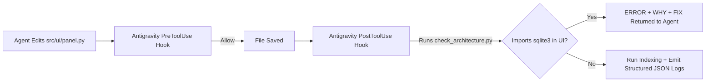

import QuizCard from '../../../components/islands/QuizCard';
import ColabButton from '../../../components/static/ColabButton.astro';

When a Knowledge Base indexing job silently fails on large Markdown files, an agent without runtime logs has to guess where the bug lives. It might rewrite half your database layer or change SQLite schemas before noticing an off-by-one chunking bug.

In **Project 04**, we compare two workspaces side by side:
- **Starter**: Weak diagnostics, no architectural boundary script, and a seeded defect in `indexing_service.py` that breaks large-file chunking (for instance, `step = size - overlap <= 0` or unbounded loop conditions). Without structured logs, the agent spends far more turns reproducing and localizing the root cause.
- **Solution**: Structured JSON runtime logger (`logger.py` tracking startup, import, indexing, and error states), an automated architectural boundary script (`check_architecture.py`), the fixed chunking logic, and Google Antigravity `PreToolUse` / `PostToolUse` hooks in `.agents/hooks.json`.

Here is how the feedback loop works in practice: whenever the agent edits a UI file and accidentally imports `sqlite3` directly instead of calling `services/kb_service.py`, the `PostToolUse` hook runs `check_architecture.py` and feeds an actionable `ERROR / WHY / FIX` message straight back into the agent's context. The agent corrects the architectural violation immediately, before it ever reaches a commit. By comparing how many turns it takes to fix the seeded indexing bug with and without structured runtime logs, you see firsthand why observability and mechanical boundaries speed up debugging.

---

## Runtime Signals + Mechanical Architecture Enforcement



| Guardrail | What It Catches | Google Antigravity Hook Integration |
| :--- | :--- | :--- |
| **`logger.py` (Structured JSON)** | Startup, import, chunking, and error states with `doc_id` & `size_bytes` | Surfaces exact failure line in tool output |
| **`check_architecture.py` (AST)** | Prevents UI layer from importing `sqlite3` directly (must use `services/`) | Triggered via `PostToolUse` (`matcher: "edit_file\|write_file"`) |
| **`PreToolUse` Safety Gate** | Blocks destructive shell commands (`rm -rf`, `DROP TABLE`) | Returns `{"decision": "deny", "reason": "..."}` |

---

## Open the Companion Colab Notebook

Launch the companion notebook to reproduce the seeded large-file chunking defect, inspect structured JSON logs, run the AST architectural boundary checker, and test `PreToolUse` / `PostToolUse` protojson payloads.

<ColabButton
  course="harness-engineering"
  notebook="12-project-04-runtime-feedback-and-architecture-guards.ipynb"
  runtime="Free Tier CPU"
/>

---

## Try It Yourself: Structured Logger & AST Boundary Guard

Run this Python script to catch a forbidden `sqlite3` import in UI code with an actionable `ERROR / WHY / FIX` message and trace a chunking failure via structured logs.

**Project 04 AST Boundary Guard & Logger**

```python
import ast, json

ui_code = "import sqlite3\ndef render(): return sqlite3.connect('kb.db')"
tree = ast.parse(ui_code)
for node in ast.walk(tree):
    if isinstance(node, ast.Import) and any(a.name == "sqlite3" for a in node.names):
        print("[AST Guard] ERROR: Direct 'sqlite3' import in ui_panel.py")
        print("  WHY: UI layer must stay decoupled from persistence.")
        print("  FIX: Call services.kb_service.list_docs() instead.")

def safe_chunk(words: list[str], size: int, overlap: int) -> dict:
    step = size - overlap
    if step <= 0:
        return {"event": "chunk_error", "doc": "large.md", "reason": "step <= 0 infinite loop guard"}
    return {"event": "chunk_ok", "chunks": len(words) // step}

print("[Runtime Log]", safe_chunk(["a"] * 100, size=50, overlap=50))
```

**Expected Output:**

```text
[AST Guard] ERROR: Direct 'sqlite3' import in ui_panel.py
  WHY: UI layer must stay decoupled from persistence.
  FIX: Call services.kb_service.list_docs() instead.
[Runtime Log] {'event': 'chunk_error', 'doc': 'large.md', 'reason': 'step <= 0 infinite loop guard'}
```

---

## Check Your Understanding

<QuizCard
  client:visible
  question="In Google Antigravity's `.agents/hooks.json`, how does a `PreToolUse` hook block an unsafe command before it executes?"
  options={[
    "It prints a warning to `AGENTS.md`.",
    "It reads the camelCase `toolCall` payload from stdin and writes `{'decision': 'deny', 'reason': '...'}` to stdout.",
    "It deletes the user's workspace.",
    "It waits 30 seconds and exits with code 0."
  ]}
  correctAnswer={1}
  explanation="Antigravity `PreToolUse` hooks receive the `toolCall` JSON on stdin and return `decision: 'deny'` (or `'ask'` / `'force_ask'` / `'allow'`) on stdout before the tool runs."
/>
