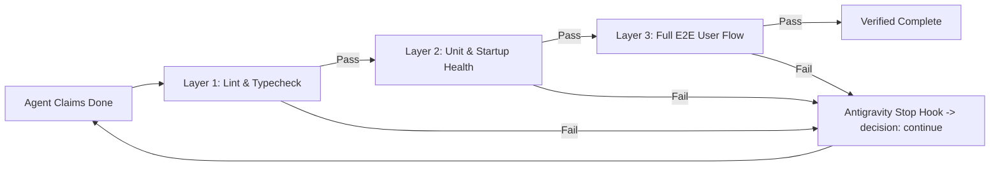

import PythonRunner from '../../../components/islands/PythonRunner';
import QuizCard from '../../../components/islands/QuizCard';
import ColabButton from '../../../components/static/ColabButton.astro';

You ask an agent to implement password reset. It updates the schema, writes the endpoint, adds the email template, runs unit tests (all green!), and confidently declares *"all done."* Yet when you click the reset link in staging, the email service config is missing and the end-to-end flow has never executed once.

This is not random carelessness. As Guo et al. (ICML 2017) demonstrated, modern neural networks exhibit **Confidence Calibration Bias**: their self-reported confidence systematically exceeds actual correctness. Worse, Anthropic found that when an agent evaluates its own output, it behaves like its own defense attorney—praising half-finished work.

---

## Why Unit Tests Alone Lie + 3-Layer Termination Gate

Unit tests mock dependencies in isolation, which blinds them to **interface mismatches**, **state propagation bugs**, and **environment config gaps**. And when agents start *"refactoring while we're at it"* before verifying core behavior, they silently break working paths.

**Google Antigravity** turns this into deterministic runtime enforcement via **`Stop` hooks** in `.agents/hooks.json`. When the agent finishes a turn without calling tools (`terminationReason: "NO_TOOL_CALL"`), your `Stop` hook runs the 3-layer gate and returns `{"decision": "continue", "reason": "..."}` if checks fail—checking `continuationActive` so it never loops infinitely. Notice also how Anthropic's three-agent experiment (Planner + Generator + Evaluator) proved this: the single bare Opus 4.5 run cost \$9 and left game entities unresponsive, whereas separating the Evaluator with real click-through verification made core gameplay work.

| Validation Layer | What It Checks | Failure Action |
| :--- | :--- | :--- |
| **Layer 1: Static** | `ruff check` + `mypy --strict` | Block Layer 2; return exact file/line |
| **Layer 2: Runtime** | App startup health + unit tests | Block Layer 3; include repair hint |
| **Layer 3: System E2E** | Complete user flow with real DB/API | Trigger `Stop` hook `decision: "continue"` |

---

## Open the Companion Colab Notebook

Launch the companion notebook to run a **3-Layer Termination Gate** and a **Google Antigravity `Stop` hook** handler with `continuationActive` loop-protection.

<ColabButton
  course="harness-engineering"
  notebook="13-preventing-premature-victory-and-confidence-calibration.ipynb"
  runtime="Free Tier CPU"
/>

---

## Try It Yourself: 3-Layer Termination Gate & `Stop` Hook

Execute this Python script to see how a Google Antigravity `Stop` hook blocks a premature exit when Layer 3 (E2E) fails and allows exit only when all three layers pass.

<PythonRunner
  client:visible
  title="Try it Yourself: 3-Layer Gate & Antigravity Stop Hook"
  expectedOutput="Run 1 (E2E failed): {'decision': 'continue', 'reason': 'Layer 3 E2E failed: POST /reset returned 500'}
Run 2 (All 3 layers pass): {'decision': 'allow'}"
  initialCode={`def stop_hook(layers: dict[str, bool], continuation_active: bool) -> dict:
    if not layers["L1_static"]:
        return {"decision": "continue", "reason": "Layer 1 static check failed"}
    if not layers["L2_runtime"]:
        return {"decision": "continue", "reason": "Layer 2 runtime check failed"}
    if not layers["L3_e2e"] and not continuation_active:
        return {"decision": "continue", "reason": "Layer 3 E2E failed: POST /reset returned 500"}
    return {"decision": "allow"}

print("Run 1 (E2E failed):", stop_hook({"L1_static": True, "L2_runtime": True, "L3_e2e": False}, False))
print("Run 2 (All 3 layers pass):", stop_hook({"L1_static": True, "L2_runtime": True, "L3_e2e": True}, False))`}
/>

---

## Check Your Understanding

<QuizCard
  client:visible
  question="Why should a Google Antigravity `Stop` hook inspect `continuationActive` before returning `{'decision': 'continue'}`?"
  options={[
    "To delete failing unit tests automatically.",
    "To prevent an infinite continuation loop when a Stop hook has already forced the agent to continue within the same turn.",
    "To disable `mypy` type checking.",
    "To bypass the Terminal Sandbox."
  ]}
  correctAnswer={1}
  explanation="In Antigravity's Stop hook contract, `continuationActive` is `true` while the agent is executing work requested by a prior Stop hook in the same turn, preventing infinite re-entry."
/>
