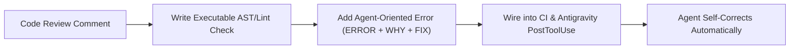

import PythonRunner from '../../../components/islands/PythonRunner';
import QuizCard from '../../../components/islands/QuizCard';
import ColabButton from '../../../components/static/ColabButton.astro';

Imagine an app where the UI layer, the service layer, and the database layer each pass 100% of their mocked unit tests—yet clicking **Export** fails because of a relative vs. absolute path mismatch, a missing progress event, and an unclosed file handle. Unit tests are systematically blind to **component boundary defects**.

The **Testing Adequacy Gradient** states that $\text{Defects}_{\text{Unit}} \subseteq \text{Defects}_{\text{Integration}} \subseteq \text{Defects}_{\text{E2E}}$. Even better: when an agent knows end-to-end verification will run, its coding behavior shifts—it designs cleaner interfaces, respects layer boundaries, and handles error paths upfront.

---

## Layered Domain Architecture & Review Feedback Promotion

OpenAI established strict **Layered Domain Architecture** on day one so agents would not copy inconsistent patterns:

`Types → Config → Repo → Service → Runtime → UI`

Dependencies flow strictly forward, and cross-domain concerns enter only through explicit Providers. Whenever a human reviewer spots a recurring mistake, promote it through **Review Feedback Promotion**:

An **Agent-Oriented Error Message** never just says `"Violation"`. It includes three parts—**what failed (`ERROR`)**, **why the invariant exists (`WHY`)**, and **how to repair it (`FIX`)**—turning every lint failure into an autonomous self-correction loop.

In a real Electron/desktop file-export case study, unit tests passed across the renderer, preload, and service layers because each mocked its neighbors. Yet end-to-end testing immediately caught five boundary defects: an interface path mismatch, dropped IPC progress state, leaked file handles on large exports, packaged permission errors, and swallowed service exceptions. Promoting those findings into permanent CI and `PostToolUse` checks ensures your harness never suffers the same failure twice.

| Defect Category | Unit Test (Mocked) | End-to-End Test (Real) |
| :--- | :--- | :--- |
| **Interface Mismatch** (relative vs. absolute path) | Missed | **Caught** |
| **State Propagation** (progress event dropped) | Missed | **Caught** |
| **Resource Leak** (unclosed file handle) | Missed | **Caught** |
| **Environment Permission** (missing secret/config) | Missed | **Caught** |

---

## Open the Companion Colab Notebook

Launch the companion notebook to run an AST **Layered Domain Architecture** linter emitting `ERROR / WHY / FIX` diagnostics and an end-to-end Knowledge Base pipeline test.

<ColabButton
  course="harness-engineering"
  notebook="14-end-to-end-verification-and-agent-oriented-errors.ipynb"
  runtime="Free Tier CPU"
/>

---

## Try It Yourself: Layered Architecture Linter with `ERROR / WHY / FIX`

Run this Python AST checker to enforce `Types -> Repo -> Service -> UI` import direction and emit actionable agent-oriented fix instructions.

<PythonRunner
  client:visible
  title="Try it Yourself: Agent-Oriented Layer Linter"
  expectedOutput="ERROR: src/repo/store.py imports 'services.auth' (upward dependency)
WHY: Layered Domain Architecture enforces Types -> Config -> Repo -> Service -> Runtime -> UI.
FIX: Inject an AuthProvider interface into Repo instead of importing Service directly."
  initialCode={`import ast

LAYER_ORDER = {"types": 0, "config": 1, "repo": 2, "services": 3, "runtime": 4, "ui": 5}

def check_layer_imports(file_layer: str, source_code: str) -> list[str]:
    violations = []
    tree = ast.parse(source_code)
    for node in ast.walk(tree):
        if isinstance(node, ast.ImportFrom) and node.module:
            target_layer = node.module.split(".")[0]
            if target_layer in LAYER_ORDER and LAYER_ORDER[target_layer] > LAYER_ORDER[file_layer]:
                violations.append(
                    f"ERROR: src/{file_layer}/store.py imports '{node.module}' (upward dependency)\n"
                    f"WHY: Layered Domain Architecture enforces Types -> Config -> Repo -> Service -> Runtime -> UI.\n"
                    f"FIX: Inject an AuthProvider interface into Repo instead of importing Service directly."
                )
    return violations

bad_repo_code = "from services.auth import get_current_user"
for msg in check_layer_imports("repo", bad_repo_code):
    print(msg)`}
/>

---

## Check Your Understanding

<QuizCard
  client:visible
  question="What makes an error message 'Agent-Oriented' in harness engineering?"
  options={[
    "It exits silently with code 1 so the agent guesses what failed.",
    "It includes three explicit elements: what went wrong (ERROR), why the rule exists (WHY), and concrete repair steps (FIX).",
    "It sends an email to the repository owner.",
    "It disables all future linting checks."
  ]}
  correctAnswer={1}
  explanation="Agent-oriented error messages turn test and lint failures into self-correcting loops by giving the agent both the invariant rationale and the exact repair path."
/>
