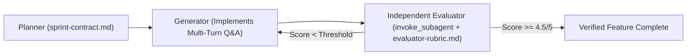

import PythonRunner from '../../../components/islands/PythonRunner';
import QuizCard from '../../../components/islands/QuizCard';
import ColabButton from '../../../components/static/ColabButton.astro';

If the same agent plans a feature, writes the code, and grades its own work, what score will it give itself? Almost always a glowing pass—even when edge cases are broken. In **Project 05**, we hold one product upgrade constant—adding **Multi-Turn Conversation History** to our Knowledge Base Q&A—and vary only **role separation** across three architectures:

1. **`single-role` (1.6 / 5.0)**: One agent plans, codes, and self-reviews in a single context.
2. **`gen-eval` (3.3 / 5.0)**: A Generator implements, and a fresh-context Evaluator critiques against `evaluator-rubric.md` with revision notes.
3. **`plan-gen-eval` (4.9 / 5.0)**: A Planner negotiates `sprint-contract.md`, a Generator builds to contract, and an independent Evaluator verifies end-to-end using Google Antigravity's `invoke_subagent`.

---

## Three-Role Separation in Google Antigravity

| Architecture Variant | Rubric Score | Typical Failure / Finding |
| :--- | :--- | :--- |
| **`single-role`** | `1.6 / 5.0` | Self-approves despite missing context carryover & empty-history crash |
| **`gen-eval`** | `3.3 / 5.0` | Evaluator catches history truncation bug; Generator revises |
| **`plan-gen-eval`** | `4.9 / 5.0` | Sprint contract locks multi-turn schema & edge cases before coding starts |

By keeping the exact same feature—multi-turn Q&A conversation history—constant across all three runs, you isolate **role separation** as the only variable. Notice how in `single-role`, the agent rationalizes away missing edge-case tests; in `gen-eval`, the independent evaluator forces a concrete revision cycle; and in `plan-gen-eval`, negotiating `sprint-contract.md` upfront prevents misunderstandings before a single line of Python is written. Even better, inspecting the evaluator's own logs lets you tighten its scoring rubric whenever it turns too lenient.

---

## Open the Companion Colab Notebook

Launch the companion notebook to run all three role architectures on the **Multi-Turn Knowledge Base Q&A** upgrade with `google-genai` (`gemini-2.5-flash`) and compare their `evaluator-rubric.md` scores.

<ColabButton
  course="harness-engineering"
  notebook="15-project-05-role-separation-and-grounded-qa-verification.ipynb"
  runtime="Free Tier CPU"
/>

---

## Try It Yourself: Multi-Turn Q&A & 3-Variant Rubric Scorer

Run this Python script to simulate the multi-turn Knowledge Base Q&A upgrade and score all three role-separation variants against `evaluator-rubric.md`.

<PythonRunner
  client:visible
  title="Try it Yourself: Project 05 Role Separation Scorer"
  expectedOutput="Variant 1 (single-role): 1.6/5.0 -> FAIL (missing follow-up context)
Variant 2 (gen-eval): 3.3/5.0 -> REVISED (fixed truncation, minor UI gap)
Variant 3 (plan-gen-eval): 4.9/5.0 -> PASS (sprint contract + E2E verified)"
  initialCode={`def score_variant(name: str, scores: list[float], note: str) -> str:
    avg = sum(scores) / len(scores)
    verdict = "PASS" if avg >= 4.5 else ("REVISED" if avg >= 3.0 else "FAIL")
    return f"{name}: {avg:.1f}/5.0 -> {verdict} ({note})"

print(score_variant("Variant 1 (single-role)", [2.0, 1.5, 1.3], "missing follow-up context"))
print(score_variant("Variant 2 (gen-eval)", [3.5, 3.4, 3.0], "fixed truncation, minor UI gap"))
print(score_variant("Variant 3 (plan-gen-eval)", [5.0, 4.9, 4.8], "sprint contract + E2E verified"))`}
/>

---

## Check Your Understanding

<QuizCard
  client:visible
  question="Why did `plan-gen-eval` (4.9/5) outperform `single-role` (1.6/5) in Project 05 even though the same underlying model was used?"
  options={[
    "Because `plan-gen-eval` disabled all unit tests.",
    "Because separating Planner, Generator, and a fresh-context Evaluator eliminates self-evaluation bias and aligns expectations upfront via `sprint-contract.md`.",
    "Because `single-role` had twice as many tokens.",
    "Because `plan-gen-eval` skipped multi-turn conversation history."
  ]}
  correctAnswer={1}
  explanation="Separating the maker from a fresh-context checker (and anchoring both to an explicit sprint contract and rubric) prevents the model from grading its own work generously."
/>
