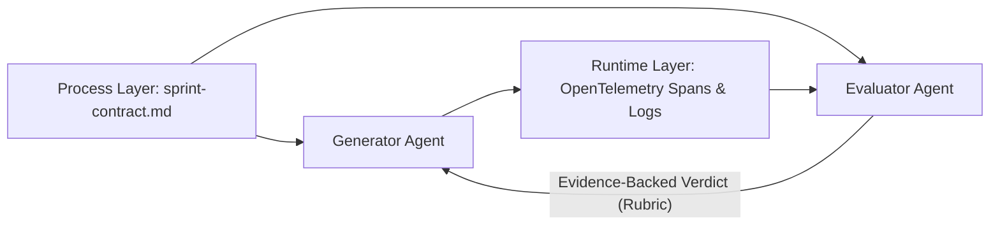

import QuizCard from '../../../components/islands/QuizCard';
import ColabButton from '../../../components/static/ColabButton.astro';

When an agent runs for twenty minutes, edits ten files, and says *"done, except two tests failed—might be a timing issue,"* the model is not necessarily weak. Your harness is **blind**. Without observability, evaluations turn into guesswork, retries wander blindly, and session handoffs hit an information cliff.

Observability is not *"add a few `print()` statements."* Agents do not know what signals they are missing, and ad-hoc logs vary from session to session. Instead, you need **Dual-Layer Observability** built directly into the harness:

1. **Runtime Observability**: System-level telemetry (lifecycle events, feature path traces, data flow, resource usage, full error context) answering *"what did the system actually do?"*
2. **Process Observability**: Harness decision artifacts (`sprint-contract.md` and `evaluator-rubric.md`) answering *"why should this change be accepted?"*

---

## Dual-Layer Observability & Anthropic's 3-Agent DAW Run



In Anthropic's March 2026 browser DAW experiment (`Opus 4.6`, total **3 hr 50 min**, **\$124.70** across Planner, 3 Build rounds, and 3 QA rounds), the QA evaluator did not say *"it feels off."* Grounded in runtime browser inspection and a 4-dimension rubric, it reported concrete evidence: *"clips cannot be dragged, and there is no synth knob or EQ curve panel."* Even better, when early evaluator versions were too generous, engineers inspected the evaluator's own logs and calibrated its QA prompt until it matched human judgment.

| Observability Layer | Primary Artifacts | Standardizes |
| :--- | :--- | :--- |
| **Runtime Layer** | OpenTelemetry `trace_id` (session) → `span_id` (task) → sub-spans (checks) | Execution paths, latency, exceptions |
| **Process Layer** | `sprint-contract.md` (scope + exclusions) & `evaluator-rubric.md` (A–D grades) | Acceptance criteria & reproducible scoring |

By the way, **sprint contracts** and **evaluator rubrics** also solve the session handoff cliff: when a task spans multiple sessions, the next agent does not have to guess why a change was rejected or what threshold remains unmet. Every trace, span, and rubric score lives in the repository as inspectable evidence.

---

## Open the Companion Colab Notebook

Launch the companion notebook to emit **OpenTelemetry-style session/task/verification spans** and evaluate a simulated sprint against `sprint-contract.md` and `evaluator-rubric.md`.

<ColabButton
  course="harness-engineering"
  notebook="16-runtime-and-process-observability.ipynb"
  runtime="Free Tier CPU"
/>

---

## Try It Yourself: OpenTelemetry Task Trace & Rubric Grader

Run this Python script to construct a structured task trace with nested verification sub-spans and compute an evidence-backed rubric verdict.

**OpenTelemetry Span & Rubric Grader**

```python
trace = {
    "trace_id": "session-42",
    "spans": [
        {
            "name": "task:dark_mode",
            "status": "ok",
            "subspans": [
                {"name": "verify:contrast_wcag_aa", "status": "FAIL", "evidence": "2.1:1 < 4.5:1"}
            ],
        }
    ],
}

print(f"Trace {trace['trace_id']}:")
failed_evidence = []
for sp in trace["spans"]:
    print(f"  - span {sp['name']} ({sp['status']})")
    for sub in sp["subspans"]:
        print(f"    - subspan {sub['name']} ({sub['status']}: {sub['evidence']})")
        if sub["status"] == "FAIL":
            failed_evidence.append(sub["evidence"])

verdict = "REJECTED -> Fix contrast on primary CTA button" if failed_evidence else "APPROVED"
print("Verdict:", verdict)
```

**Expected Output:**

```text
Trace session-42:
  - span task:dark_mode (ok)
    - subspan verify:contrast_wcag_aa (FAIL: 2.1:1 < 4.5:1)
Verdict: REJECTED -> Fix contrast on primary CTA button
```

---

## Check Your Understanding

<QuizCard
  client:visible
  question="What is the difference between Runtime Observability and Process Observability in a harness?"
  options={[
    "Runtime Observability uses Python; Process Observability uses JavaScript.",
    "Runtime Observability captures what the system actually executed (logs, OpenTelemetry spans, health checks), while Process Observability captures why a change should be accepted (sprint contracts and evaluator rubrics).",
    "Process Observability replaces all automated tests.",
    "Runtime Observability is only for production servers, never for coding agents."
  ]}
  correctAnswer={1}
  explanation="Both layers work together: Runtime signals show what happened at execution time, while Process artifacts (`sprint-contract.md`, `evaluator-rubric.md`) define objective acceptance standards."
/>
