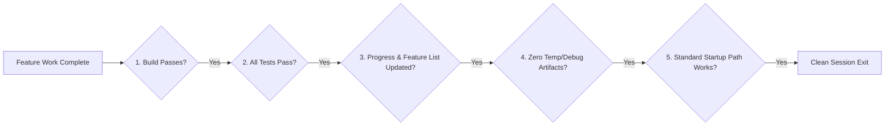

import QuizCard from '../../../components/islands/QuizCard';
import ColabButton from '../../../components/static/ColabButton.astro';

Lehman's Laws of Software Evolution warn us that changing systems inevitably grow more complex unless actively maintained. With AI coding agents, entropy accelerates—because **agents copy patterns already present in the repository, including messy or inconsistent ones**. Leave one broken window or stray debug file behind, and the next session treats it as the house style.

OpenAI initially spent every Friday (20% of engineering capacity) manually cleaning up *"AI slop"* before automating three defenses: encoding **Golden Rules** into the repo, running **periodic background cleanup agents**, and promoting review taste into automated checks.

---

## The 5 Clean State Dimensions & Dual-Mode Cleanup



In a 12-week agent project comparison, teams without cleanup saw build pass rates decay from 100% to **68%** and session startup time balloon from 5 minutes to **60+ minutes** (with 103 stale artifacts). Teams running **Immediate Cleanup** (at every session exit) plus a **Weekly Cleanup Loop** kept build pass rates at **97%** and startup under **9 minutes**.

| Practice | Rule / Heuristic | Why It Works |
| :--- | :--- | :--- |
| **Idempotent Cleanup** | `rm -f /tmp/debug-*.log && pytest -q` | Safe to re-run on retries without side effects |
| **Quality Document (`QUALITY.md`)** | Grade each module (`A`–`D`) across 5 health axes | Next session prioritizes lowest-graded module first |
| **Monthly Harness Simplification** | Disable 1 harness rule/component and benchmark | Removes scaffolding absorbed by newer models |
| **High-Throughput Merge** | Fast short-lived PRs when $C_{\text{fix}} < C_{\text{wait}}$ (fixing a rare bug later costs less than waiting on slow manual reviews) | Avoids human review bottlenecks on high-velocity repos |

Remember the golden rule: **"clean up later" means never cleaning up.** When a session exits with red tests or stray temporary files, the next session spends its first thirty minutes fighting fires instead of shipping features. Enforcing clean state as part of your Definition of Done keeps your baseline trustworthy week after week.

---

## Open the Companion Colab Notebook

Launch the companion notebook to run a **5-Dimension Clean State Gate**, score modules in `QUALITY.md`, and execute an idempotent cleanup scanner.

<ColabButton
  course="harness-engineering"
  notebook="17-clean-session-exits-and-entropy-control.ipynb"
  runtime="Free Tier CPU"
/>

---

## Try It Yourself: 5-Dimension Clean Exit & `QUALITY.md` Grader

Run this Python script to evaluate all five clean-state dimensions and rank modules in `QUALITY.md` so the next session fixes the weakest area first.

**Clean State Gate & Quality Grader**

```python
clean_checks = {
    "build_passes": True,
    "tests_pass": True,
    "progress_updated": True,
    "no_debug_artifacts": False,
    "startup_works": True,
}
failed = [k for k, ok in clean_checks.items() if not ok]
print("Clean Exit Gate:", "PASSED" if not failed else f"BLOCKED (failed: {', '.join(failed)})")

modules = [
    ("Auth Module", "A", 5),
    ("Payment Module", "C", 2),
]
print("Module Priority Queue (lowest grade first):")
for idx, (name, grade, score) in enumerate(sorted(modules, key=lambda x: x[2]), 1):
    print(f"  {idx}. {name}: Grade {grade} (score {score}/5)")
```

**Expected Output:**

```text
Clean Exit Gate: BLOCKED (failed: no_debug_artifacts)
Module Priority Queue (lowest grade first):
  1. Payment Module: Grade C (score 2/5)
  2. Auth Module: Grade A (score 5/5)
```

---

## Check Your Understanding

<QuizCard
  client:visible
  question="Why should you periodically run a 'Monthly Harness Simplification' ablation?"
  options={[
    "To delete all unit tests once a month.",
    "Because as foundation models improve, constraints that were essential three months ago may become unnecessary overhead—disabling and benchmarking them keeps the harness lean.",
    "Because `AGENTS.md` files expire after 30 days.",
    "To force agents to re-read the entire codebase every session."
  ]}
  correctAnswer={1}
  explanation="Anthropic's Opus 4.5 -> 4.6 transition showed that stronger models absorb some scaffolding (like rigid sprint splits), so periodic ablation keeps your harness minimal and high-signal."
/>
