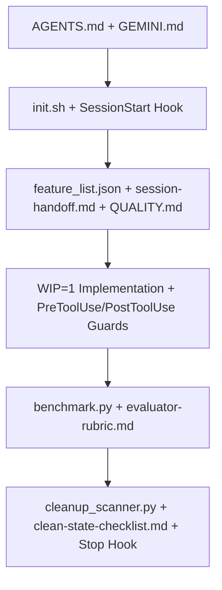

import PythonRunner from '../../../components/islands/PythonRunner';
import QuizCard from '../../../components/islands/QuizCard';
import ColabButton from '../../../components/static/ColabButton.astro';

Unlike earlier projects where product features were missing, in **Project 06 (Capstone)** the Knowledge Base code is mostly complete—document import, chunking, citation Q&A, runtime logging, and multi-turn history are all there. The gap is the **operating harness around the application**.

You will assemble all five subsystems into one cohesive Google Antigravity harness, run a full benchmark, execute an idempotent cleanup pass, and perform a **5-Subsystem Ablation Study** to prove which components drive reliability.

---

## Complete Capstone Harness Architecture & `harness-creator` Patterns

To package this cleanly across repositories, apply the **`harness-creator` skill patterns**:

| `harness-creator` Pattern | Problem Solved | Key Artifact |
| :--- | :--- | :--- |
| **Memory Persistence** | Agent forgets between sessions | `PROGRESS.md` + `DECISIONS.md` |
| **Skill Runtime** | Re-explaining workflows wastes tokens | `.agents/skills/<name>/SKILL.md` |
| **Context Engineering** | Bloated rules crowd out code | `< 24 KB` router + `docs/` pointers |
| **Tool Registry** | Unsafe or broken tool calls | `PreToolUse` / `PostToolUse` hooks |
| **Multi-Agent Coordination** | Self-evaluation bias & file collisions | `invoke_subagent` (`workspace: "share"`) |
| **Lifecycle & Bootstrap** | Premature exits & dirty handoffs | `init.sh`, `SessionStart`, `Stop` hooks |

Watch out for the classic harness gotchas as you run your capstone: never store mutable runtime state inside `AGENTS.md`, never let a single agent both implement and grade its own `feature_list.json` row, and never skip `cleanup_scanner.py` after a benchmark run. By comparing the weak starter (which has working product code but a thin `AGENTS.md` and zero handoff/checklist files) against your full capstone harness, you will see how dramatically the operating environment governs reliability. Once your benchmark and cleanup pass cleanly, remove one subsystem at a time to verify its real marginal contribution. Document those ablation findings in `QUALITY.md` so future sessions know which guardrails are load-bearing and which can be simplified. Every verified run builds lasting confidence in your entire engineering harness.

---

## Open the Companion Colab Notebook

Launch the companion notebook to run the complete **Capstone Benchmark**, **Cleanup Scanner**, and **5-Subsystem Ablation Study** on the Knowledge Base harness.

<ColabButton
  course="harness-engineering"
  notebook="18-project-06-capstone-complete-agent-harness-and-ablation.ipynb"
  runtime="Free Tier CPU"
/>

---

## Try It Yourself: Capstone Benchmark & Cleanup Scanner

Run this Python capstone runner to verify all 8 required harness artifacts, execute the cleanup scanner, and summarize the ablation results.

<PythonRunner
  client:visible
  title="Try it Yourself: Project 06 Capstone Harness Benchmark"
  expectedOutput="Capstone Artifact Check: 8/8 present -> PASS
Cleanup Scanner: 0 stale artifacts -> CLEAN
Ablation Study Winner (largest drop when removed): Verification Gates (-38%)"
  initialCode={`required_artifacts = [
    "AGENTS.md", "GEMINI.md", "init.sh", "feature_list.json",
    "session-handoff.md", "clean-state-checklist.md", "QUALITY.md", ".agents/hooks.json"
]
present = set(required_artifacts)
missing = [a for a in required_artifacts if a not in present]
print(f"Capstone Artifact Check: {len(present)}/{len(required_artifacts)} present -> {'PASS' if not missing else 'FAIL'}")

stale_files = []  # cleanup_scanner.py result
print(f"Cleanup Scanner: {len(stale_files)} stale artifacts -> {'CLEAN' if not stale_files else 'DIRTY'}")

ablation_drops = {"Verification Gates": 38, "Modular AGENTS.md": 26, "State Handoff": 22, "Init Script": 14}
top_component = max(ablation_drops.items(), key=lambda kv: kv[1])
print(f"Ablation Study Winner (largest drop when removed): {top_component[0]} (-{top_component[1]}%)")`}
/>

---

## Check Your Understanding

<QuizCard
  client:visible
  question="In Project 06 (Capstone), why do we run a 5-subsystem ablation study after assembling the full harness?"
  options={[
    "To randomly delete files until the build breaks.",
    "To measure the marginal contribution of each harness component on your real task set so you know what drives reliability and what can be simplified.",
    "To replace `feature_list.json` with a blank README.",
    "To avoid running `cleanup_scanner.py`."
  ]}
  correctAnswer={1}
  explanation="An ablation study removes one harness component at a time while keeping the model fixed, revealing which constraints deliver real reliability gains."
/>
