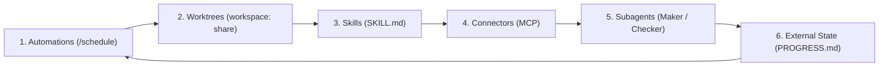

import PythonRunner from '../../../components/islands/PythonRunner';
import QuizCard from '../../../components/islands/QuizCard';
import ColabButton from '../../../components/static/ColabButton.astro';

Everything in Modules 1–4 rested on one assumption: **you are sitting at the keyboard, typing the next prompt.** You inspect the progress file, pick the next feature, and nudge the agent forward. **Loop Engineering** moves you outside the loop. As Addy Osmani framed it, loop engineering is replacing yourself as the person who prompts the agent—your leverage shifts from *writing the right prompt* to *designing the right loop*.

The simplest possible loop is **`/goal`**: you provide a **goal**, a **verification method**, and an independent **stopping condition**, then walk away.

---

## `/goal` vs. `/loop` (`/schedule`) & The 6 Loop Primitives

Do not confuse a **goal-based loop** (`/goal`) with a **time-based loop** (`/loop` or `/schedule` in Google Antigravity):
- **Has an end?** Use **`/goal`** (e.g., *"Implement full payment tests until 100% pass"*). It runs continuously until an independent judge confirms done.
- **No end—just keep watching?** Use **`/schedule`** (e.g., *"Check CI failures every 30 minutes"*). Each cron tick runs independently.

| Loop Pattern | Mechanism | Key Reliability Guarantee |
| :--- | :--- | :--- |
| **Maker-Checker Split** | Implementer writes code; separate Verifier reviews | *"Someone in your crew must not believe you"* |
| **Karpathy's `autoresearch` Ratchet** | `prepare.py` (read-only) + `train.py` (agent) + `program.md` (human) | Keep commit only if `val_bpb` improves; else `git reset HEAD~1` (10.9% GPT-2 speedup) |

---

## The 4 Silent Costs & 5-Level Maturity Ladder

Autonomous loops accelerate output—and risk. Watch for **Four Silent Costs**:
1. **Verification Debt**: Never let stopping conditions rely on *"feels right."*
2. **Comprehension Rot**: Fast loops outpace your mental model—review diffs and summaries regularly.
3. **Cognitive Surrender**: Use loops to amplify thinking, never to avoid thinking.
4. **Quadratic Token Blowout**: Re-sending growing history across $N$ rounds scales input cost as $\mathcal{O}(N^2)$ unless you compact or reset state on disk.

| Maturity Level | Description | Google Antigravity Mapping |
| :--- | :--- | :--- |
| **Level 1: Goal Runner** | Single `/goal` with stopping condition | `/goal` slash command |
| **Level 2: Scheduled Single-Task** | Cron/heartbeat automation | `/schedule` cron job |
| **Level 3: Multi-Agent Loop** | Maker & Checker in isolated worktrees | `invoke_subagent` with `workspace: "share"` |
| **Level 4: Self-Feeding Loop** | Discovers next task from `feature_list.json` | Loop + External State |
| **Level 5: Fleet Orchestration** | Parallel independent loops sharing memory | Swarm / `run_workflow` |

---

## Open the Companion Colab Notebook

Launch the companion notebook to run a **Karpathy-style 9-step Ratchet Loop**, a **Maker-Checker Controller**, and a **Linear vs. Quadratic Token Blowout** simulator.

<ColabButton
  course="harness-engineering"
  notebook="19-loop-engineering-from-manual-prompting-to-autonomous-loops.ipynb"
  runtime="Free Tier CPU"
/>

---

## Try It Yourself: Ratchet Loop & Quadratic Token Blowout

Run this Python script to simulate a 4-round `autoresearch` ratchet (keeping only verified improvements) and compare $\mathcal{O}(N^2)$ raw history cost against $\mathcal{O}(N)$ compacted external state.

<PythonRunner
  client:visible
  title="Try it Yourself: Ratchet Loop & Token Cost Simulator"
  expectedOutput="Round 1: val_bpb=1.234 -> KEEP (baseline)
Round 2: val_bpb=1.228 -> KEEP (improved)
Round 3: val_bpb=1.241 -> REVERT (git reset HEAD~1)
Round 4: val_bpb=1.219 -> KEEP (improved)
10-Round Cumulative Tokens -> Uncompacted O(N^2): 55000 | External State O(N): 10000"
  initialCode={`experiments = [(1, 1.234, "baseline"), (2, 1.228, "lr +10%"), (3, 1.241, "gelu"), (4, 1.219, "weight decay")]
best = float("inf")
for r, val, desc in experiments:
    if val < best:
        best = val
        action = "KEEP (baseline)" if r == 1 else "KEEP (improved)"
    else:
        action = "REVERT (git reset HEAD~1)"
    print(f"Round {r}: val_bpb={val:.3f} -> {action}")

rounds = 10
per_round = 1000
uncompacted = sum(per_round * i for i in range(1, rounds + 1))
external_state = per_round * rounds
print(f"10-Round Cumulative Tokens -> Uncompacted O(N^2): {uncompacted} | External State O(N): {external_state}")`}
/>

---

## Check Your Understanding

<QuizCard
  client:visible
  question="When should you use `/goal` instead of a recurring `/schedule` (or `/loop`) timer?"
  options={[
    "When a monitoring task runs forever with no end state.",
    "When the task has a clear finish line and verifiable stopping condition so each iteration builds cumulatively toward completion.",
    "Only when you want to disable verification.",
    "When you want every iteration to forget all prior progress."
  ]}
  correctAnswer={1}
  explanation="`/goal` drives one cumulative task to a verifiable finish line, whereas `/schedule` (`/loop`) triggers independent periodic checks with no terminal end."
/>
