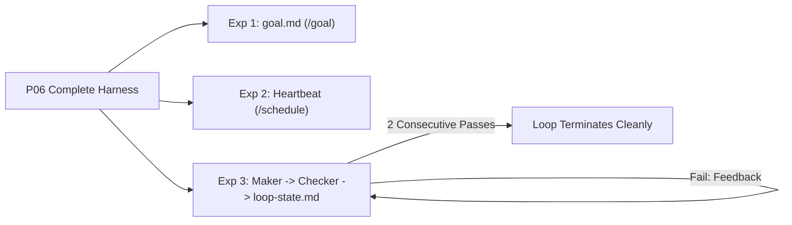

import QuizCard from '../../../components/islands/QuizCard';
import ColabButton from '../../../components/static/ColabButton.astro';

In Project 06 (Capstone), you assembled a complete static harness for the Python Knowledge Base. Now in **Project 07**, you turn that harness into an **autonomous loop** across three progressive experiments:

1. **Experiment 1 (`p07-goal-loop`)**: Convert a manual task (*"reach 80% test coverage and zero lint errors on KB modules"*) into `goal.md` with an explicit stopping condition and run it via `/goal`.
2. **Experiment 2 (`p07-timer-loop`)**: Turn a repetitive health check (running `pytest` and scanning stale `TODO` markers) into a recurring `/schedule` heartbeat.
3. **Experiment 3 (`p07-maker-checker`)**: Build a 5-round **Maker-Checker loop** driven by `loop-state.md`, where an isolated Checker agent verifies every Maker edit without sharing the Maker's reasoning bias.

---

## Three-Experiment Loop Progression



| Experiment | Input Artifact | Stop Condition | Key Metric to Track |
| :--- | :--- | :--- | :--- |
| **Exp 1: Goal Loop** | `goal.md` (goal + verify + exclusions) | Coverage $\ge 80\%$ or max turns | Human interventions saved vs. manual |
| **Exp 2: Timer Loop** | Monitoring prompt + cron cadence | Manual stop or clean exit | False-positive rate vs. real catches |
| **Exp 3: Maker-Checker** | `maker_prompt`, `checker_prompt`, `loop-state.md` | 2 consecutive passes or max 5 rounds | Issues caught by Checker alone |

Notice how **Experiment 3** maps directly to Google Antigravity's `google-antigravity` Python SDK (`Agent`, `LocalAgentConfig`, `CapabilitiesConfig`): you spawn the Maker `Agent` with write capabilities, commit or snapshot its output, then spawn a fresh Checker `Agent` in read-only mode so it cannot rubber-stamp the Maker's work. After running at least five rounds, review `loop-state.md` to audit how often you intervened, whether the Checker missed any regressions, and whether the loop's quality ceiling came from the Maker or the Checker.

---

## Open the Companion Colab Notebook

Launch the companion notebook to execute all three Project 07 experiments—including a live `google-genai` (`gemini-2.5-flash`) 5-round **Maker-Checker loop** writing `loop-state.md`.

<ColabButton
  course="harness-engineering"
  notebook="20-project-07-building-automated-goal-timer-and-maker-checker-loops.ipynb"
  runtime="Free Tier CPU"
/>

---

## Try It Yourself: 5-Round Maker-Checker Loop Controller

Run this Python loop controller to execute a multi-round Maker-Checker cycle with `loop-state.md` tracking and a 2-consecutive-pass stop condition.

**Project 07 Maker-Checker Loop**

```python
def run_maker_checker(max_rounds: int = 5, target_streak: int = 2):
    streak = 0
    rounds = [
        ("wrote chunker", False, "missing empty-text guard"),
        ("added empty-text guard", True, "ok"),
        ("added edge tests", True, "ok"),
    ]
    for r_num, (maker_act, checker_ok, note) in enumerate(rounds[:max_rounds], 1):
        if checker_ok:
            streak += 1
            print(f"Round {r_num}: Maker {maker_act} -> Checker PASS (streak={streak})")
            if streak >= target_streak:
                print(f"Loop Stopped: {target_streak} consecutive passes reached!")
                break
        else:
            streak = 0
            print(f"Round {r_num}: Maker {maker_act} -> Checker FAIL ({note})")

run_maker_checker()
```

**Expected Output:**

```text
Round 1: Maker wrote chunker -> Checker FAIL (missing empty-text guard)
Round 2: Maker added empty-text guard -> Checker PASS (streak=1)
Round 3: Maker added edge tests -> Checker PASS (streak=2)
Loop Stopped: 2 consecutive passes reached!
```

---

## Check Your Understanding

<QuizCard
  client:visible
  question="In Project 07 Experiment 3, why must the Checker agent run in a fresh context (or read-only `LocalAgentConfig`) separate from the Maker agent?"
  options={[
    "So the Checker can delete the Maker's Git history.",
    "Because a Maker evaluating its own reasoning context is systematically overconfident; a fresh Checker catches edge cases and stubbed behavior.",
    "Because Python does not support functions inside loops.",
    "To make the loop run slower."
  ]}
  correctAnswer={1}
  explanation="Separating Maker and Checker contexts prevents self-evaluation bias and ensures stopping conditions are judged objectively."
/>
