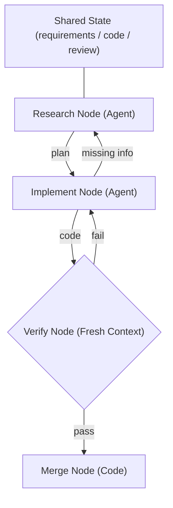

import QuizCard from '../../../components/islands/QuizCard';
import ColabButton from '../../../components/static/ColabButton.astro';

In July 2026, *"Graph Engineering"* exploded across social feeds—sparked partly by a joke tweet and accompanied by viral, fabricated numbers (*"+18% accuracy, -85% cost"* that actually came from two unrelated baselines in a chemical piping diagram paper). Yet the underlying engineering shift is completely real.

As Rohit's 4-layer stack explains, **Prompt → Context → Loop → Graph** stacks upward on top of your **Harness foundation**: once a single loop needs specialization, parallelism, shared state, and explicit rollback paths, it stops being a loop and becomes a **Graph**.

---

## Single Loop Failures vs. Explicit Graph Architecture

Why does a single loop break at scale?
1. **Goodhart's Law**: The loop games a single metric (closing support tickets early) while hurting real outcomes (churn).
2. **Blindness Upward**: A loop never asks *"is this the right goal?"*
3. **Multi-Loop Conflict**: Speed loops undermine quality loops.
4. **Missing Anchors**: Without real-world anchors (ground-truth evals, human spot-checks), coupled loops drift together.



Unlike traditional workflows where nodes are purely deterministic functions, a **Graph Engineering node can be a full agent** with its own private prompt, context, and inner loop—handing off only through **Shared State** with explicit merge reducers. Keep Addy Osmani's **Orchestration Tax** in mind, though: *"You are the GIL of your AI agents"*—meaning your human review attention is single-threaded (one PR at a time), even when agents run in parallel. Launching parallel nodes is cheap; your review bandwidth is serial. Only draw a graph when at least 3 of 5 criteria hold: independent decomposability, branch/rollback paths, checkpointable intermediate state, verifiable node outputs, and coordination benefits > overhead.

| Graph Component | Responsibility | Antigravity (`run_workflow`) / LangGraph |
| :--- | :--- | :--- |
| **Node** | Agent, deterministic check, or human gate | `agent(...)` / `phase(...)` / `StateGraph` node |
| **Edge** | Sequence, parallel fan-out, conditional rollback | `parallel(...)` / `pipeline(...)` / `add_conditional_edges` |
| **Shared State** | Typed dict with overwrite/append/sum reducers | `TypedDict` state + `Annotated` reducers |
| **Checkpoint** | Persist state after every step for resume/HITL | `MemorySaver` / `interrupt_before` |

---

## Open the Companion Colab Notebook

Launch the companion notebook to run the **6-Step Graph Construction Blueprint** (Research → Implement → Fresh-Context Verify → Merge) with checkpoints and conditional rollback edges.

<ColabButton
  course="harness-engineering"
  notebook="21-graph-engineering-nodes-edges-shared-state-and-routing.ipynb"
  runtime="Free Tier CPU"
/>

---

## Try It Yourself: 4-Node Graph Router & Checkpoint Simulator

Run this Python graph engine to execute Research → Implement → Verify (with rollback on fail) → Merge while saving checkpoints at every step.

**4-Node Graph & Conditional Rollback**

```python
state = {"requirements": "", "code": "", "review": "", "attempts": 0}
checkpoints = []

def run_graph():
    node = "research"
    step = 0
    while node != "END":
        step += 1
        if node == "research":
            state["requirements"] = "drafted spec"
            print(f"Step {step} [research]: {state['requirements']} (attempts={state['attempts']})")
            node = "implement"
        elif node == "implement":
            state["attempts"] += 1
            state["code"] = f"code_v{state['attempts']}"
            print(f"Step {step} [implement]: {state['code']} (attempts={state['attempts']})")
            node = "verify"
        elif node == "verify":
            # Fresh-context check: v1 fails, v2 passes
            if state["code"] == "code_v1":
                state["review"] = "fail"
                print(f"Step {step} [verify]: FAIL -> rolling back to implement")
                node = "implement"
            else:
                state["review"] = "pass"
                print(f"Step {step} [verify]: PASS -> routing to merge")
                node = "merge"
        elif node == "merge":
            checkpoints.append(dict(state))
            print(f"Step {step} [merge]: committed cleanly (checkpoints={len(checkpoints)})")
            node = "END"
            continue
        checkpoints.append(dict(state))

run_graph()
```

**Expected Output:**

```text
Step 1 [research]: drafted spec (attempts=0)
Step 2 [implement]: code_v1 (attempts=1)
Step 3 [verify]: FAIL -> rolling back to implement
Step 4 [implement]: code_v2 (attempts=2)
Step 5 [verify]: PASS -> routing to merge
Step 6 [merge]: committed cleanly (checkpoints=6)
```

---

## Check Your Understanding

<QuizCard
  client:visible
  question="What is the primary architectural difference between a traditional deterministic workflow and Graph Engineering?"
  options={[
    "Graphs cannot have conditional branches.",
    "Traditional workflow nodes are deterministic functions with hardcoded edges, whereas Graph Engineering widens nodes to full self-looping agents and supports dynamic routing + fresh-context verification.",
    "Graph Engineering forbids saving checkpoints.",
    "Workflows never use directed edges."
  ]}
  correctAnswer={1}
  explanation="Graph Engineering generalizes workflows by allowing nodes to be autonomous agents with private contexts while keeping replayability, checkpoints, and explicit routing."
/>
