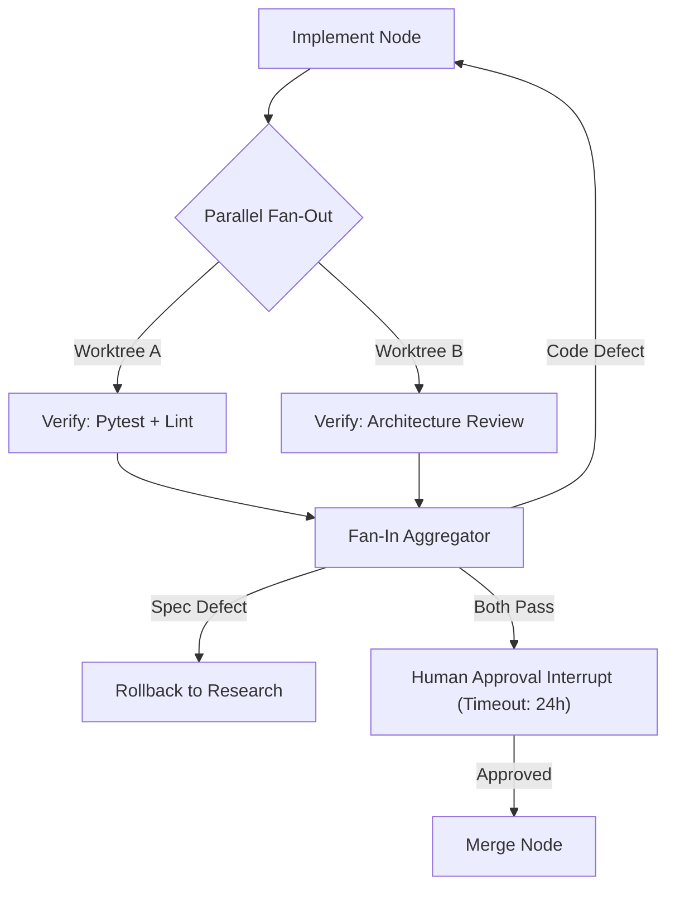

import PythonRunner from '../../../components/islands/PythonRunner';
import QuizCard from '../../../components/islands/QuizCard';
import ColabButton from '../../../components/static/ColabButton.astro';

In Project 07, your Maker-Checker loop hid every routing decision inside a single context window. In **Project 08**, you unfold that loop onto paper (`graph.md` + `state.md`) and run three progressive experiments:

1. **Experiment 1 (`p08-explicit-graph`)**: List every node, edge, shared state field, and routing rule—and uncover at least one **implicit edge** you did not realize existed inside the old loop.
2. **Experiment 2 (`p08-parallel`)**: Add a **parallel fan-out / fan-in** verification stage (tests + lint in one branch, security + architecture review in another) isolated via `workspace: "share"` / git worktrees.
3. **Experiment 3 (`p08-human-in-the-loop`)**: Add **layer-targeted rollback** (spec misunderstandings roll back to `research`; code bugs roll back to `implement`) plus a **Human-Approval interrupt node** before `merge` with a timeout/escalation rule.

---

## Fan-Out / Fan-In & Layer-Targeted Rollback

In Google Antigravity, you express this directly in **`run_workflow`** using `parallel(...)` for independent fan-out checks, `pipeline(...)` for sequential stages, and `phase(...)` for staged execution—while writing the shared `state.md` contract so every node knows which fields it owns. When you compare wall-clock runtime and token cost before and after parallelizing, watch closely for whether coordination overhead eats the savings—and record whether your Human-in-the-Loop approval gate caught architectural issues that automated tests missed. Explicit graphs turn hidden agent assumptions into inspectable engineering artifacts.

| Experiment | Branch | Key Artifact | Verification Question |
| :--- | :--- | :--- | :--- |
| **Exp 1: Explicit Graph** | `p08-explicit-graph` | `graph.md` + `state.md` | Which implicit edge was surfaced? |
| **Exp 2: Parallel Fan-Out** | `p08-parallel` | Fan-out/fan-in merge rule | Did parallelism beat coordination cost? |
| **Exp 3: HITL & Rollback** | `p08-human-in-the-loop` | Interrupt payload + timeout rule | Did rollback pinpoint the exact defect layer? |

---

## Open the Companion Colab Notebook

Launch the companion notebook to run the complete **Project 08 Parallel Fan-Out/Fan-In & HITL Graph** in `LangGraph` + `run_workflow`-style orchestration.

<ColabButton
  course="harness-engineering"
  notebook="22-project-08-multi-agent-graph-workflows-parallelism-and-hitl.ipynb"
  runtime="Free Tier CPU"
/>

---

## Try It Yourself: Parallel Fan-In & Layer-Targeted Rollback

Execute this Python script to simulate parallel verification fan-in, layer-targeted rollback (`research` vs. `implement`), and a Human-in-the-Loop approval gate.

<PythonRunner
  client:visible
  title="Try it Yourself: Project 08 Fan-In & HITL Router"
  expectedOutput="Fan-In [tests=True, review=False, defect_layer='research'] -> Rollback to: research
Fan-In [tests=True, review=True, defect_layer='none'] -> Paused at HITL -> Approved -> Merge Complete"
  initialCode={`def route_after_fan_in(tests_ok: bool, review_ok: bool, defect_layer: str) -> str:
    if tests_ok and review_ok:
        return "hitl_approval"
    return "research" if defect_layer == "research" else "implement"

r1 = route_after_fan_in(True, False, "research")
print(f"Fan-In [tests=True, review=False, defect_layer='research'] -> Rollback to: {r1}")

r2 = route_after_fan_in(True, True, "none")
human_decision = "Approved"
print(f"Fan-In [tests=True, review=True, defect_layer='none'] -> Paused at HITL -> {human_decision} -> Merge Complete")`}
/>

---

## Check Your Understanding

<QuizCard
  client:visible
  question="In Project 08 Experiment 3, why is layer-targeted rollback superior to always bouncing failures back to the `implement` node?"
  options={[
    "Because it skips running tests altogether.",
    "Because if the root cause is an ambiguous requirement, rolling back to `research` fixes the spec instead of forcing `implement` to guess repeatedly.",
    "Because `implement` cannot read `state.md`.",
    "Because human approval nodes never time out."
  ]}
  correctAnswer={1}
  explanation="Recording which layer caused the defect lets the graph route spec errors back to `research` and code errors back to `implement`, avoiding wasted retries."
/>
