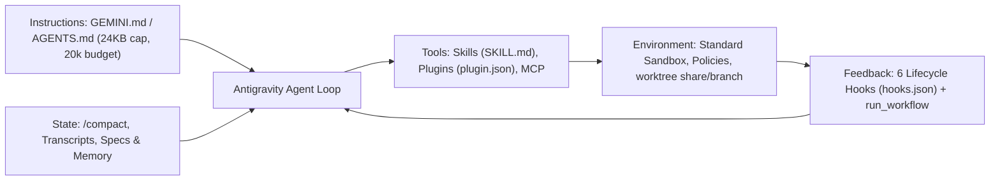

import QuizCard from '../../../components/islands/QuizCard';
import ColabButton from '../../../components/static/ColabButton.astro';

Throughout this course, we have mapped harness theory directly onto **Google Antigravity**. Think of this lesson as the full workshop blueprint: let's inspect the entire **Google Antigravity** platform through our formal **5-Subsystem Harness Framework** ($\mathcal{H} = \langle I, T, E, S, F \rangle$) so you know exactly how every surface, budget, hook, and sandbox fits together.

Antigravity ships across four synchronized surfaces: **Antigravity 2.0** (desktop Electron orchestrator with Scheduled Tasks and the HTML Auxiliary Pane), **Antigravity IDE** (Passive Tab/Supercomplete/Tab-to-Jump, Instructive `Ctrl+I`, Collaborative Sidebar Agent/Planning Mode, Inline Code Lenses, Visual Diffs, and Diagnostic Auto-Fix), **Antigravity CLI (`agy`)** (configured via `~/.gemini/antigravity-cli/settings.json`), and the **Antigravity Python SDK** (`pip install google-antigravity` with `Agent`, `LocalAgentConfig`, and `CapabilitiesConfig`). Together, they let you move seamlessly from interactive editing to headless CI automation.

---

## Mapping Google Antigravity to the 5 Harness Subsystems



| Subsystem | Google Antigravity Implementation | Key Invariant / Limit |
| :--- | :--- | :--- |
| **1. Instructions ($I$)** | 5-level precedence: Workspace CWD→root → `skills.json`/`plugins.json` → `~/.gemini/config/` → Built-in → Global configs | `24 KB` per-file cap; `20,000`-token `defaultRulesBudget` (pointer demotion: swapping overflow text for a file path); path deduplication |
| **2. Tools ($T$)** | Progressive-disclosure `.agents/skills/*/SKILL.md`, namespaced `plugins/<name>/plugin.json`, `mcp_config.json` (Stdio & Streamable HTTP) | Metadata-only injection until triggered; legacy HTTP+SSE unsupported |
| **3. Environment ($E$)** | Standard Sandbox Mode (`BypassSandbox: false`), Tool Execution Policies (`always-proceed`, `request-review`, `strict`, `proceed-in-sandbox`), `invoke_subagent` (`inherit`/`share`/`branch`) | Network & outside-workspace writes blocked in sandbox; `share` isolates concurrent writers |
| **4. State ($S$)** | `/compact` context compression, append-only `transcript.jsonl`, `A11Y-DECISIONS` & OKF memory, SDD specs | Read-only default in Python SDK unless `CapabilitiesConfig()` is passed |
| **5. Feedback ($F$)** | `.agents/hooks.json`: `SessionStart`, `PreToolUse`, `PostToolUse`, `PreInvocation`, `PostInvocation`, `Stop` + `/goal`, `/schedule`, `run_workflow` | Synchronous camelCase protojson `stdin`/`stdout`; `PreToolUse` supports `overwrite` & `deny` |

---

## Open the Companion Colab Notebook

Launch the companion notebook to validate `.agents/hooks.json` schemas, resolve Antigravity's 5-level rule precedence, and simulate `google.antigravity.Agent` (`LocalAgentConfig` + `CapabilitiesConfig`) streaming `response.thoughts` and `response.tool_calls`.

<ColabButton
  course="harness-engineering"
  notebook="23-google-antigravity-harness-architecture-deep-dive.ipynb"
  runtime="Free Tier CPU"
/>

---

## Try It Yourself: Antigravity 5-Level Precedence & Hook Contract Validator

Run this Python script to resolve Google Antigravity's 5-level customization precedence and validate a `.agents/hooks.json` lifecycle configuration.

**Antigravity Precedence & Hook Validator**

```python
precedence = [
    ("Level 1 (Workspace Project)", {"code-review": ".agents/skills/code-review"}),
    ("Level 2 (Declared skills.json)", {"code-review": "shared/skills/code-review"}),
    ("Level 3 (Global ~/.gemini/config/)", {"code-review": "~/.gemini/config/skills/code-review"}),
    ("Level 4 (Built-in)", {"code-review": "builtin/code-review"}),
]

winner = next((lvl, paths["code-review"]) for lvl, paths in precedence if "code-review" in paths)
print(f"Winning skill 'code-review' from: {winner[0]}")

SUPPORTED_EVENTS = {"SessionStart", "PreToolUse", "PostToolUse", "PreInvocation", "PostInvocation", "Stop"}
hooks_cfg = ["SessionStart", "PreToolUse", "PostToolUse", "Stop"]
valid = [h for h in hooks_cfg if h in SUPPORTED_EVENTS]
print(f"Hooks Validated: {valid} -> {len(valid)}/{len(hooks_cfg)} valid")
```

**Expected Output:**

```text
Winning skill 'code-review' from: Level 1 (Workspace Project)
Hooks Validated: ['SessionStart', 'PreToolUse', 'PostToolUse', 'Stop'] -> 4/4 valid
```

---

## Check Your Understanding

<QuizCard
  client:visible
  question="In Google Antigravity, what happens if the same skill name exists in both `<project>/.agents/skills/` and `~/.gemini/config/skills/`?"
  options={[
    "Both fail to load due to a fatal collision.",
    "The Workspace Project skill (Level 1) overrides the Global Discovery skill (Level 3) because workspace-scoped customizations have highest priority.",
    "The Built-in skill always wins over workspace skills.",
    "Antigravity randomly picks one per turn."
  ]}
  correctAnswer={1}
  explanation="Antigravity's 5-level loading priority places Workspace Project customizations at Level 1 (highest), overriding Global Discovery (Level 3) and Built-in defaults (Level 4)."
/>
